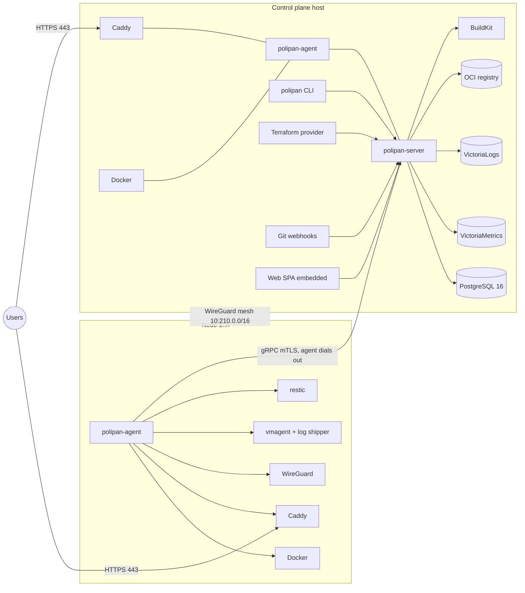
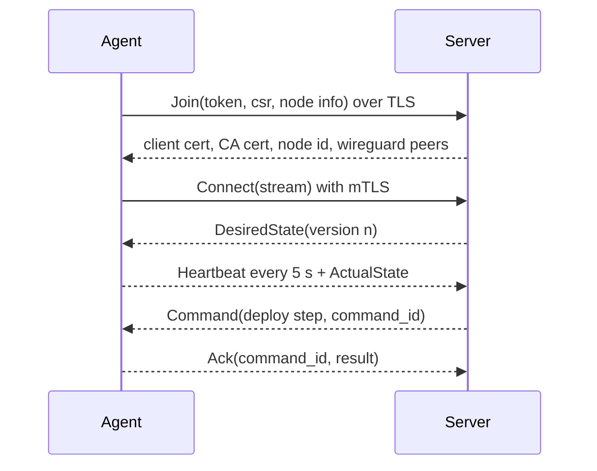
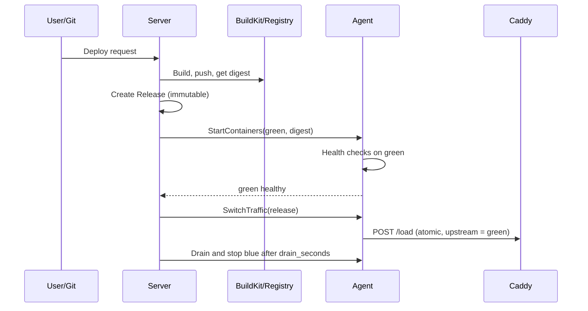

# 02 – Architecture

All choices here are final for v1. Names and numbers come from the [glossary](01-glossary.md).

## 1. Components



| Component | Binary / product | Role |
|---|---|---|
| Server | `polipan-server` (Go) | API, UI hosting, scheduler, deploy engine, job queue, CA, audit, alert engine. |
| Agent | `polipan-agent` (Go) | Runs on every node. Reconciles Docker containers, Caddy config, WireGuard, backups, health checks, metrics and log shipping. |
| CLI | `polipan` (Go, cobra) | Talks only to the public API. |
| Terraform provider | `terraform-provider-polipan` (Go) | Talks only to the public API. |
| Web UI | React SPA | Built to static files and embedded in `polipan-server`. |
| Database | PostgreSQL 16 | All control-plane state. |
| Metrics | VictoriaMetrics single-node | Time series, `metrics_retention`. |
| Logs | VictoriaLogs | Log storage and search (LogsQL), `logs_retention`. |
| Registry | CNCF `distribution` registry | Stores built images, pulled by digest over the mesh. |
| Builder | BuildKit, as a container on the control-plane host | Builds with `dockerfile` or `railpack` for the CPU architecture of that host ([Q-10](15-open-questions.md)). |
| Ingress | Caddy 2 on every node | TLS, routing, weighted upstreams. |
| Backups | restic | Encrypted, deduplicated snapshots to many targets. |

## 2. Tech stack and reasons

| Area | Choice | Reason |
|---|---|---|
| Server, agent, CLI, provider | Go 1.23+ | Strong Docker, gRPC and Terraform libraries. Static binaries. One language for all binaries. |
| Agent protocol | gRPC over mTLS, agent dials out, one bidirectional stream | Works behind NAT. Only ingress and WireGuard ports are open on workers. |
| Runtime | Plain Docker Engine 25+ | Full control of blue-green and canary steps. Swarm rolling update cannot gate on health and cannot do weights. |
| Ingress | Caddy 2, admin API `POST /load` (atomic) | One atomic config swap is the instant switch to another image address. Automatic HTTPS (Let's Encrypt, ZeroSSL fallback). |
| Network | WireGuard mesh, `mesh_cidr` | Any ingress reaches any service on any node. Needed for failover and moves. |
| DB | PostgreSQL 16 | Relational, JSONB for snapshots, row locks for the queue. |
| Queue | Postgres table, `SELECT … FOR UPDATE SKIP LOCKED` | No Redis. One less moving part. |
| Metrics | VictoriaMetrics | Long retention, small size, Prometheus compatible. |
| Logs | VictoriaLogs | Full-text and field search, no Elasticsearch. |
| Builds | BuildKit, Railpack, Dockerfile | Railpack is the open successor of Nixpacks. |
| Images | Built-in registry, external registries allowed | A release points to a digest. Every node pulls the same digest. |
| Backups | restic | S3-compatible, B2, SFTP, local, Azure Blob, GCS. Built-in `check`. |
| UI | React 18, TypeScript, Vite, TanStack Query and Router, Tailwind, shadcn/ui | Common stack, easy for agents. |
| API | REST/JSON, OpenAPI 3.1 is the source of truth, SSE for streams, WebSocket for terminal | One API for UI, CLI and Terraform. |
| Auth | argon2id, TOTP, session cookie + CSRF, API tokens `pp_`, OIDC and GitHub OAuth2 | See [10-security](10-security.md). |
| Secrets | Envelope encryption, AES-256-GCM | See [10-security](10-security.md). |
| License | Apache-2.0 | No lock-in. See [F11](04-features/F11-open-source.md). |
| Node OS | Ubuntu 22.04/24.04, Debian 12, amd64 and arm64 | |

## 3. Repository layout (monorepo, to be created by M0)

```text
/server                 polipan-server (Go): api, scheduler, deploy engine, queue, auth, audit, alerts
/agent                  polipan-agent (Go): reconciler, docker, caddy, wireguard, health, backup, metrics
/cli                    polipan CLI (Go)
/terraform-provider     provider (Go)
/web                    React SPA
/proto                  agent.proto (copy of docs/spec/schemas/agent.proto) and generated code
/api                    openapi.yaml (copy of docs/spec/openapi.yaml) and generated clients
/deploy                 installer script, docker compose for the control plane, systemd units
/docs                   the spec (docs/spec) and user docs
/templates              built-in service templates (YAML)
/test                   e2e suites and fixtures
```

The layout is required by REQ-CORE-010. Code in `/server` MUST NOT import code from `/agent` except shared packages in `/server/internal/shared` or generated proto code.

## 4. Key flows

### 4.1 Agent connection



Protocol detail: [09-multi-server](09-multi-server.md).

### 4.2 Deploy (blue-green)



Details and states: [08-deploy-engine](08-deploy-engine.md).

## 5. Server internals

- **Modules** (Go packages under `/server/internal`): `api`, `auth`, `rbac`, `audit`, `secrets`, `projects`, `services`, `releases`, `deploy`, `scheduler`, `nodes`, `agentgw`, `builds`, `registry`, `domains`, `backups`, `alerts`, `obs`, `git`, `previews`, `templates`, `queue`, `config` (config as code).
- **Queue:** the table `jobs` (see [03-data-model](03-data-model.md)). Workers lock rows with SKIP LOCKED. Jobs have `kind`, `payload`, `attempts`, `run_at`, `unique_key`. Retry with exponential back-off, max 5 attempts.
- **Locks:** one active Deployment per (service, environment) is enforced by a unique partial index. Node-level actions use advisory locks.
- **Events:** all state changes write to `events` and are pushed to SSE subscribers.
- **Config:** server reads `/etc/polipan/server.yaml` and env vars `POLIPAN_*`. Env wins.
- **Files on the control-plane host:** `/etc/polipan/master.key` (KEK, mode 0400), `/var/lib/polipan/` (data), CA key in the database encrypted with the KEK.

## 6. Agent internals

- Keeps `/var/lib/polipan-agent/desired.json` (last desired state) and acts alone when the server is gone.
- Loops: reconcile (every `reconcile_interval` and on new version), health (per check interval), metrics push, log shipping, backup runner, WireGuard peer sync.
- Owns the Caddy config on its node. Nobody else writes it. The agent builds the full JSON from desired state and sends it with one `POST /load`.
- Containers are labeled `polipan.service`, `polipan.release`, `polipan.env`, `polipan.color`.
- Each node has one Docker bridge network `polipan0` whose subnet is the node's /24 from `mesh_cidr`. WireGuard routes every node's /24 to that node, so a container IP is reachable from any node. Containers get DNS names `<service>.<env>.polipan.internal` served by the agent's embedded DNS (it answers with the container IPs of live placements, from desired state).
- The agent keeps nftables rules so a container can reach only containers of its own environment and the ingress Caddy. Caddy runs on the host network and reaches container IPs directly.

## 7. Network and ports

| Port | Where | Use |
|---|---|---|
| 80, 443 TCP | ingress nodes | Public HTTP(S). |
| 443 TCP | control plane | UI and API (behind Caddy of the control-plane node). |
| 9443 TCP | control plane | Agent gRPC (mTLS). |
| 51820 UDP | every node | WireGuard. |
| Caddy admin | unix socket on node | Only the agent can reach it. |
| Docker socket | unix socket on node | Only the agent can reach it. |

## 8. Installation

- Control plane: one-line install script that installs Docker, then runs server, PostgreSQL, VictoriaMetrics, VictoriaLogs and registry as containers with a compose file in `/deploy`. Example: `curl -fsSL https://get.polipan.dev | sh`.
- Worker node: `polipan node add` prints a one-line command with a join token (see [09-multi-server](09-multi-server.md)).

## Requirements

- **REQ-CORE-004** (MUST) Server, agent, CLI and Terraform provider are Go binaries built from one monorepo with the layout in section 3.
- **REQ-CORE-005** (MUST) All control-plane state is in PostgreSQL. The server process is stateless apart from files named in section 5.
- **REQ-CORE-006** (MUST) The agent dials out. The server MUST NOT need an inbound connection to a worker node.
- **REQ-CORE-007** (MUST) When the server is down, running services and their Caddy config keep working on every node.
- **REQ-CORE-008** (MUST) Only the agent writes the Caddy config and talks to the Docker socket on a node.
- **REQ-CORE-009** (MUST) The public API is the only interface the UI, CLI and Terraform provider use. No private endpoints for them.
- **REQ-CORE-010** (MUST) The repository follows the layout in section 3.
- **REQ-CORE-011** (MUST) The job queue lives in PostgreSQL. No Redis or other broker.
- **REQ-CORE-012** (SHOULD) The control plane installs on a 2 vCPU / 4 GB RAM server and a worker node on 1 vCPU / 1 GB RAM.
