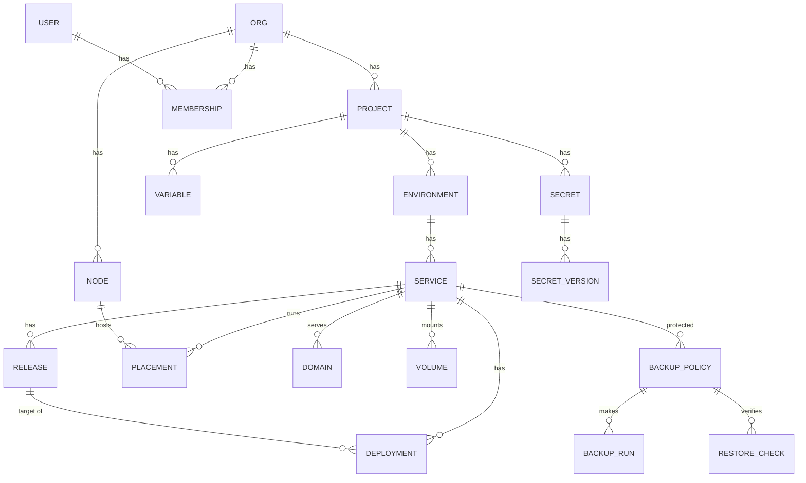

# 03 – Data Model

PostgreSQL 16. All ids are text `<prefix>_<ULID>` (see [glossary](01-glossary.md#id-prefixes)). All tables have `created_at timestamptz not null default now()` unless noted. Mutable tables also have `updated_at`. Enum values are in [glossary](01-glossary.md#fixed-enumerations) and are stored as `text` with a `CHECK` constraint. The DDL needs the PostgreSQL extension `citext` (`CREATE EXTENSION citext` in the first migration). The DDL below is a schema description. Build agents create migrations from it (one migration file per milestone, numbered).

## 1. Hierarchy



## 2. Rules that apply to the whole model

- **Release is immutable.** Rows in `releases` are never updated, except the field `pruned_at` (image removed). Deleting a service deletes its releases.
- **One active deployment** per (service, environment): unique partial index `deployments_one_active`.
- **Secrets never appear** in `config_snapshot`, `audit_events.diff`, logs or API responses. Only secret names and version numbers do.
- **Audit log is append-only.** The DB role used by the server has INSERT and SELECT only on `audit_events`.
- **Soft delete** (`deleted_at`) is used for orgs, projects, environments, services and users. A purge job removes rows 30 days after deletion.
- **Snapshots are JSONB** with a `schema_version` key.

## 3. Tables

### 3.1 Identity and access

```sql
CREATE TABLE orgs (
  id text PRIMARY KEY,                       -- org_
  name text NOT NULL,
  slug text NOT NULL UNIQUE,
  sso_required boolean NOT NULL DEFAULT false,
  settings jsonb NOT NULL DEFAULT '{}',      -- retention overrides, default domain suffix, preview wildcard domain
  deleted_at timestamptz,
  created_at timestamptz NOT NULL DEFAULT now(),
  updated_at timestamptz NOT NULL DEFAULT now()
);

CREATE TABLE users (
  id text PRIMARY KEY,                       -- usr_
  email citext NOT NULL UNIQUE,
  name text NOT NULL,
  password_hash text,                        -- argon2id, null for SSO-only users
  totp_secret_enc bytea,                     -- encrypted with the server KEK
  totp_enabled boolean NOT NULL DEFAULT false,
  recovery_codes_hash text[] NOT NULL DEFAULT '{}',
  disabled boolean NOT NULL DEFAULT false,
  last_login_at timestamptz,
  deleted_at timestamptz,
  created_at timestamptz NOT NULL DEFAULT now(),
  updated_at timestamptz NOT NULL DEFAULT now()
);

CREATE TABLE memberships (
  id text PRIMARY KEY,                       -- mem_
  org_id text NOT NULL REFERENCES orgs(id),
  user_id text NOT NULL REFERENCES users(id),
  role text NOT NULL CHECK (role IN ('owner','admin','developer','viewer')),
  source text NOT NULL DEFAULT 'manual' CHECK (source IN ('manual','sso')),
  created_at timestamptz NOT NULL DEFAULT now(),
  UNIQUE (org_id, user_id)
);

CREATE TABLE invitations (
  id text PRIMARY KEY,
  org_id text NOT NULL REFERENCES orgs(id),
  email citext NOT NULL,
  role text NOT NULL CHECK (role IN ('owner','admin','developer','viewer')),
  token_hash text NOT NULL UNIQUE,
  invited_by text REFERENCES users(id),
  expires_at timestamptz NOT NULL,           -- 7 days
  accepted_at timestamptz,
  created_at timestamptz NOT NULL DEFAULT now()
);

CREATE TABLE password_resets (
  token_hash text PRIMARY KEY,
  user_id text NOT NULL REFERENCES users(id),
  expires_at timestamptz NOT NULL,           -- 1 hour
  used_at timestamptz
);

CREATE TABLE teams (
  id text PRIMARY KEY,                       -- team_
  org_id text NOT NULL REFERENCES orgs(id),
  name text NOT NULL,
  created_at timestamptz NOT NULL DEFAULT now(),
  UNIQUE (org_id, name)
);

CREATE TABLE team_members (
  team_id text NOT NULL REFERENCES teams(id) ON DELETE CASCADE,
  user_id text NOT NULL REFERENCES users(id),
  PRIMARY KEY (team_id, user_id)
);

-- Project-level role override. Exactly one of user_id or team_id is set.
CREATE TABLE project_roles (
  id text PRIMARY KEY,
  project_id text NOT NULL REFERENCES projects(id) ON DELETE CASCADE,
  user_id text REFERENCES users(id),
  team_id text REFERENCES teams(id),
  role text NOT NULL CHECK (role IN ('admin','developer','viewer')),
  CHECK ((user_id IS NULL) <> (team_id IS NULL))
);

CREATE TABLE sessions (
  id text PRIMARY KEY,                       -- hash of the cookie value
  user_id text NOT NULL REFERENCES users(id),
  csrf_token_hash text NOT NULL,
  ip inet, user_agent text,
  expires_at timestamptz NOT NULL,
  absolute_expires_at timestamptz NOT NULL,
  created_at timestamptz NOT NULL DEFAULT now()
);

CREATE TABLE api_tokens (
  id text PRIMARY KEY,                       -- tok_
  org_id text NOT NULL REFERENCES orgs(id),
  user_id text NOT NULL REFERENCES users(id),
  name text NOT NULL,
  token_hash text NOT NULL UNIQUE,           -- SHA-256 of the full token, token starts with pp_
  token_prefix text NOT NULL,                -- first 8 chars, for display
  scopes text[] NOT NULL,                    -- see 10-security, e.g. {'read','deploy','admin'}
  project_id text REFERENCES projects(id),   -- optional: limit token to one project
  expires_at timestamptz,
  last_used_at timestamptz,
  revoked_at timestamptz,
  created_at timestamptz NOT NULL DEFAULT now()
);

CREATE TABLE sso_providers (
  id text PRIMARY KEY,                       -- sso_
  org_id text NOT NULL REFERENCES orgs(id),
  kind text NOT NULL CHECK (kind IN ('oidc','google','github')),
  name text NOT NULL,
  issuer_url text,                           -- oidc only
  client_id text NOT NULL,
  client_secret_enc bytea NOT NULL,          -- encrypted with the server KEK
  scopes text[] NOT NULL DEFAULT '{openid,email,profile}',
  groups_claim text,                         -- claim name that holds groups
  allowed_domains text[] NOT NULL DEFAULT '{}',
  default_role text CHECK (default_role IN ('owner','admin','developer','viewer')),  -- null = no access without a mapping
  auto_create_users boolean NOT NULL DEFAULT true,
  enabled boolean NOT NULL DEFAULT true,
  created_at timestamptz NOT NULL DEFAULT now(),
  UNIQUE (org_id, name)
);

CREATE TABLE sso_group_mappings (
  id text PRIMARY KEY,
  sso_provider_id text NOT NULL REFERENCES sso_providers(id) ON DELETE CASCADE,
  group_value text NOT NULL,                 -- IdP group or GitHub "org/team"
  role text NOT NULL CHECK (role IN ('owner','admin','developer','viewer')),
  project_id text REFERENCES projects(id),   -- null = org-level role
  UNIQUE (sso_provider_id, group_value, project_id)
);

CREATE TABLE sso_identities (
  provider_id text NOT NULL REFERENCES sso_providers(id) ON DELETE CASCADE,
  subject text NOT NULL,                     -- stable id from the IdP
  user_id text NOT NULL REFERENCES users(id),
  PRIMARY KEY (provider_id, subject)
);
```

### 3.2 Projects, environments, services

```sql
CREATE TABLE projects (
  id text PRIMARY KEY,                       -- prj_
  org_id text NOT NULL REFERENCES orgs(id),
  name text NOT NULL,
  slug text NOT NULL,
  settings jsonb NOT NULL DEFAULT '{}',      -- retain_releases, preview_* defaults, build_timeout
  config_source jsonb,                       -- {connection_id, repo, branch, path} when managed by git
  config_sync_state text NOT NULL DEFAULT 'in_sync' CHECK (config_sync_state IN ('in_sync','drifted','plan_pending','apply_failed')),
  config_synced_commit text,
  deleted_at timestamptz,
  created_at timestamptz NOT NULL DEFAULT now(),
  updated_at timestamptz NOT NULL DEFAULT now(),
  UNIQUE (org_id, slug)
);

CREATE TABLE environments (
  id text PRIMARY KEY,                       -- env_
  project_id text NOT NULL REFERENCES projects(id),
  name text NOT NULL,
  slug text NOT NULL,
  kind text NOT NULL CHECK (kind IN ('production','staging','preview','custom')),
  protected boolean NOT NULL DEFAULT false,  -- true by default when kind = 'production'
  settings jsonb NOT NULL DEFAULT '{}',      -- strategy defaults per env, auto_deploy, preview_state
  base_env_id text REFERENCES environments(id),  -- preview: env it was cloned from
  preview_repo text,                         -- git_ connection repo full name, preview only
  preview_pr_number int,                     -- preview only
  preview_last_push_at timestamptz,
  preview_expires_at timestamptz,
  deleted_at timestamptz,
  created_at timestamptz NOT NULL DEFAULT now(),
  updated_at timestamptz NOT NULL DEFAULT now(),
  UNIQUE (project_id, slug),
  CHECK (kind <> 'preview' OR (preview_repo IS NOT NULL AND preview_pr_number IS NOT NULL))
);
CREATE UNIQUE INDEX environments_one_per_pr
  ON environments (project_id, preview_repo, preview_pr_number) WHERE kind = 'preview' AND deleted_at IS NULL;

CREATE TABLE services (
  id text PRIMARY KEY,                       -- svc_
  environment_id text NOT NULL REFERENCES environments(id),
  name text NOT NULL,
  type text NOT NULL CHECK (type IN ('app','database','worker','cron')),
  source_type text NOT NULL CHECK (source_type IN ('git','image')),
  config jsonb NOT NULL,                     -- the live config, same shape as a config_snapshot (see 07)
  git_managed_fields text[] NOT NULL DEFAULT '{}',  -- field paths set by polipan.yaml
  template_instance_id text REFERENCES template_instances(id),
  db_engine text CHECK (db_engine IN ('postgres','mysql','mariadb','mongo','redis')),
  live_release_id text,                      -- FK added after releases (deferred)
  desired_state text NOT NULL DEFAULT 'running' CHECK (desired_state IN ('running','stopped')),
  failover text NOT NULL DEFAULT 'none' CHECK (failover IN ('none','auto')),
  allow_data_loss_failover boolean NOT NULL DEFAULT false,
  deleted_at timestamptz,
  created_at timestamptz NOT NULL DEFAULT now(),
  updated_at timestamptz NOT NULL DEFAULT now(),
  UNIQUE (environment_id, name)
);

CREATE TABLE template_instances (
  id text PRIMARY KEY,
  template_id text NOT NULL,                 -- built-in template slug or custom template id
  template_version text NOT NULL,
  environment_id text NOT NULL REFERENCES environments(id),
  inputs jsonb NOT NULL DEFAULT '{}',        -- secret inputs are stored as secret refs
  created_at timestamptz NOT NULL DEFAULT now()
);

CREATE TABLE templates (
  id text PRIMARY KEY,                       -- tem_ (custom) ; built-in use slug in code
  org_id text REFERENCES orgs(id),           -- null = built-in
  slug text NOT NULL,
  version text NOT NULL,
  manifest jsonb NOT NULL,                   -- see C03
  created_at timestamptz NOT NULL DEFAULT now(),
  UNIQUE (org_id, slug, version)
);
```

### 3.3 Releases and deployments

```sql
CREATE TABLE releases (
  id text PRIMARY KEY,                       -- rel_
  service_id text NOT NULL REFERENCES services(id) ON DELETE CASCADE,
  number int NOT NULL,                       -- 1,2,3... per service, shown as v12
  image_ref text NOT NULL,                   -- repo@sha256:digest, always a digest
  image_digest text NOT NULL,
  config_snapshot jsonb NOT NULL,            -- ports, resources, health, volumes, domains, strategy, env refs
  variable_snapshot jsonb NOT NULL,          -- plain variables resolved at release time
  secret_versions jsonb NOT NULL,            -- {"DB_PASSWORD": 3}  names -> version numbers, never values
  source jsonb NOT NULL,                     -- {type, commit_sha, branch, pr_number, promoted_from_release_id, rollback_of_release_id, actor_id}
  created_by text REFERENCES users(id),
  pruned_at timestamptz,                     -- image removed from registry
  created_at timestamptz NOT NULL DEFAULT now(),
  UNIQUE (service_id, number)
);

CREATE TABLE release_annotations (
  release_id text PRIMARY KEY REFERENCES releases(id) ON DELETE CASCADE,
  note text NOT NULL,
  updated_by text REFERENCES users(id),
  updated_at timestamptz NOT NULL DEFAULT now()
);
ALTER TABLE services ADD FOREIGN KEY (live_release_id) REFERENCES releases(id);

CREATE TABLE deployments (
  id text PRIMARY KEY,                       -- dep_
  service_id text NOT NULL REFERENCES services(id) ON DELETE CASCADE,
  environment_id text NOT NULL REFERENCES environments(id),
  release_id text REFERENCES releases(id),   -- null while state = queued/building
  previous_release_id text REFERENCES releases(id),
  trigger text NOT NULL CHECK (trigger IN ('manual','git_push','pull_request','promotion','rollback','api','config_apply','failover','move','schedule')),
  strategy text NOT NULL CHECK (strategy IN ('recreate','blue_green','canary')),
  strategy_options jsonb NOT NULL DEFAULT '{}',   -- canary steps, gates, drain_seconds
  state text NOT NULL CHECK (state IN ('queued','building','image_ready','starting','health_checking','shifting','switching','draining','live','failed','rolled_back','cancelled','superseded')),
  canary_step int,                           -- current percent when state = shifting
  target_node_id text REFERENCES nodes(id),  -- for move / failover
  failure_reason text,                       -- machine code, see 08
  failure_detail text,
  actor_id text REFERENCES users(id),
  idempotency_key text,
  started_at timestamptz,
  finished_at timestamptz,
  created_at timestamptz NOT NULL DEFAULT now(),
  updated_at timestamptz NOT NULL DEFAULT now()
);
CREATE UNIQUE INDEX deployments_one_active ON deployments (service_id)
  WHERE state IN ('building','image_ready','starting','health_checking','shifting','switching','draining');
CREATE INDEX deployments_service_created ON deployments (service_id, created_at DESC);

CREATE TABLE deployment_steps (
  id bigserial PRIMARY KEY,
  deployment_id text NOT NULL REFERENCES deployments(id) ON DELETE CASCADE,
  state text NOT NULL,
  message text,
  data jsonb,
  created_at timestamptz NOT NULL DEFAULT now()
);

CREATE TABLE deployment_logs (
  deployment_id text NOT NULL REFERENCES deployments(id) ON DELETE CASCADE,
  seq bigint NOT NULL,
  stream text NOT NULL CHECK (stream IN ('build','deploy','pre_deploy')),
  line text NOT NULL,
  created_at timestamptz NOT NULL DEFAULT now(),
  PRIMARY KEY (deployment_id, seq)
);
```

`queued` is not part of the "active" index, so a queued deployment can wait while one is active. A new queued deployment marks older queued ones `superseded` (see [08-deploy-engine](08-deploy-engine.md)).

### 3.4 Nodes and placement

```sql
CREATE TABLE nodes (
  id text PRIMARY KEY,                       -- nod_
  org_id text NOT NULL REFERENCES orgs(id),
  name text NOT NULL,
  state text NOT NULL CHECK (state IN ('pending','ready','suspect','down','draining','cordoned','maintenance')),
  labels jsonb NOT NULL DEFAULT '{}',        -- e.g. {"ingress":"true","region":"eu"}
  public_ip inet, mesh_ip inet, mesh_subnet cidr,
  wireguard_public_key text,
  os text, arch text, docker_version text, agent_version text,
  capacity jsonb,                            -- {cpu_millis, memory_bytes, disk_bytes}
  last_heartbeat_at timestamptz,
  cert_serial text, cert_expires_at timestamptz,
  desired_state_version bigint NOT NULL DEFAULT 0,
  acked_state_version bigint NOT NULL DEFAULT 0,
  created_at timestamptz NOT NULL DEFAULT now(),
  updated_at timestamptz NOT NULL DEFAULT now(),
  UNIQUE (org_id, name)
);

CREATE TABLE node_join_tokens (
  id text PRIMARY KEY,
  org_id text NOT NULL REFERENCES orgs(id),
  token_hash text NOT NULL UNIQUE,
  node_name text NOT NULL,
  labels jsonb NOT NULL DEFAULT '{}',
  expires_at timestamptz NOT NULL,
  used_at timestamptz,
  created_by text REFERENCES users(id)
);

CREATE TABLE revoked_certs (
  serial text PRIMARY KEY,
  node_id text NOT NULL REFERENCES nodes(id),
  revoked_at timestamptz NOT NULL DEFAULT now()
);

CREATE TABLE placements (
  id text PRIMARY KEY,
  service_id text NOT NULL REFERENCES services(id) ON DELETE CASCADE,
  node_id text NOT NULL REFERENCES nodes(id),
  release_id text NOT NULL REFERENCES releases(id),
  replica_index int NOT NULL,
  color text NOT NULL CHECK (color IN ('blue','green')),
  role text NOT NULL CHECK (role IN ('live','candidate','draining','stopped')),
  container_id text,
  weight int NOT NULL DEFAULT 100 CHECK (weight BETWEEN 0 AND 100),
  health text NOT NULL DEFAULT 'unknown' CHECK (health IN ('unknown','starting','healthy','unhealthy')),
  created_at timestamptz NOT NULL DEFAULT now(),
  updated_at timestamptz NOT NULL DEFAULT now()
);
CREATE INDEX placements_node ON placements (node_id);
CREATE INDEX placements_service ON placements (service_id);
```

The server CA is kept in one row (M1). The private key is wrapped with the server KEK like other secrets ([10-security](10-security.md)).

```sql
CREATE TABLE server_ca (
  id int PRIMARY KEY CHECK (id = 1),         -- one row
  cert_pem text NOT NULL,
  key_enc bytea NOT NULL,                    -- private key, AES-256-GCM with the server KEK
  created_at timestamptz NOT NULL DEFAULT now()
);
```

### 3.5 Domains, volumes, variables, secrets

```sql
CREATE TABLE domains (
  id text PRIMARY KEY,                       -- dom_
  service_id text NOT NULL REFERENCES services(id) ON DELETE CASCADE,
  host text NOT NULL,                        -- lower case, may start with *. only for preview wildcard
  path_prefix text NOT NULL DEFAULT '/',
  container_port int NOT NULL,
  https boolean NOT NULL DEFAULT true,
  options jsonb NOT NULL DEFAULT '{}',       -- max_body_bytes, ip_allow, basic_auth_secret (name), headers, compression
  redirect_www text CHECK (redirect_www IN ('to_www','to_apex')),
  ingress_node_ids text[],                   -- null = all ready nodes with label ingress=true
  tls_status text NOT NULL DEFAULT 'pending' CHECK (tls_status IN ('pending','issued','failed')),
  tls_expires_at timestamptz,
  tls_error text,
  created_at timestamptz NOT NULL DEFAULT now(),
  UNIQUE (host, path_prefix)
);

CREATE TABLE volumes (
  id text PRIMARY KEY,                       -- vol_
  service_id text NOT NULL REFERENCES services(id) ON DELETE CASCADE,
  name text NOT NULL,
  kind text NOT NULL CHECK (kind IN ('volume','bind','tmpfs')),
  mount_path text NOT NULL,
  node_id text REFERENCES nodes(id),         -- node where the data lives (null for tmpfs)
  size_limit_bytes bigint,
  access_mode text NOT NULL DEFAULT 'single_writer' CHECK (access_mode IN ('single_writer','shared')),
  UNIQUE (service_id, name)
);

CREATE TABLE variables (
  id text PRIMARY KEY,                       -- var_
  project_id text NOT NULL REFERENCES projects(id) ON DELETE CASCADE,
  environment_id text REFERENCES environments(id) ON DELETE CASCADE,  -- null = shared
  service_id text REFERENCES services(id) ON DELETE CASCADE,          -- null = all services in scope
  name text NOT NULL,
  value text NOT NULL,
  preview boolean NOT NULL DEFAULT false,    -- true = also injected into preview environments
  build_time boolean NOT NULL DEFAULT false,
  git_managed boolean NOT NULL DEFAULT false
);
CREATE UNIQUE INDEX variables_scope_unique
  ON variables (project_id, COALESCE(environment_id,''), COALESCE(service_id,''), name);

CREATE TABLE data_keys (
  project_id text PRIMARY KEY REFERENCES projects(id) ON DELETE CASCADE,
  dek_enc bytea NOT NULL,                    -- DEK encrypted with the KEK
  kek_id text NOT NULL,                      -- which KEK version wrapped it
  created_at timestamptz NOT NULL DEFAULT now(),
  rotated_at timestamptz
);

CREATE TABLE secrets (
  id text PRIMARY KEY,                       -- sec_
  project_id text NOT NULL REFERENCES projects(id) ON DELETE CASCADE,
  environment_id text REFERENCES environments(id) ON DELETE CASCADE,
  service_id text REFERENCES services(id) ON DELETE CASCADE,
  name text NOT NULL,
  preview boolean NOT NULL DEFAULT false,
  build_time boolean NOT NULL DEFAULT false,
  current_version int NOT NULL DEFAULT 1,
  git_managed boolean NOT NULL DEFAULT false,
  deleted_at timestamptz
);
CREATE UNIQUE INDEX secrets_scope_unique
  ON secrets (project_id, COALESCE(environment_id,''), COALESCE(service_id,''), name) WHERE deleted_at IS NULL;

CREATE TABLE secret_versions (
  secret_id text NOT NULL REFERENCES secrets(id) ON DELETE CASCADE,
  version int NOT NULL,
  nonce bytea NOT NULL,
  ciphertext bytea NOT NULL,                 -- AES-256-GCM, AAD = secret id || version
  created_by text REFERENCES users(id),
  created_at timestamptz NOT NULL DEFAULT now(),
  destroyed_at timestamptz,
  PRIMARY KEY (secret_id, version)
);
```

### 3.6 Backups

```sql
CREATE TABLE backup_targets (
  id text PRIMARY KEY,                       -- bkp_
  org_id text NOT NULL REFERENCES orgs(id),
  name text NOT NULL,
  kind text NOT NULL CHECK (kind IN ('s3','b2','sftp','local','azure','gcs')),
  config jsonb NOT NULL,                     -- bucket, endpoint, path (no credentials)
  credentials_secret_id text NOT NULL REFERENCES secrets(id),
  last_test_at timestamptz, last_test_ok boolean,
  UNIQUE (org_id, name)
);

CREATE TABLE backup_policies (
  id text PRIMARY KEY,                       -- pol_
  service_id text REFERENCES services(id) ON DELETE CASCADE,  -- null = control-plane DB policy
  volume_id text REFERENCES volumes(id),
  schedule text NOT NULL,                    -- cron expression, UTC
  target_ids text[] NOT NULL,                -- one or more backup_targets
  retention jsonb NOT NULL,                  -- {keep_daily, keep_weekly, keep_monthly}
  repo_password_secret_id text NOT NULL REFERENCES secrets(id),
  restore_check_schedule text NOT NULL,
  restore_check_enabled boolean NOT NULL DEFAULT true,
  restore_check_mode text NOT NULL DEFAULT 'full' CHECK (restore_check_mode IN ('full','sample')),
  hooks jsonb NOT NULL DEFAULT '{}',         -- {pre: [...], post: [...]}
  enabled boolean NOT NULL DEFAULT true
);

CREATE TABLE backup_runs (
  id text PRIMARY KEY,                       -- bkr_
  policy_id text NOT NULL REFERENCES backup_policies(id) ON DELETE CASCADE,
  state text NOT NULL CHECK (state IN ('queued','running','succeeded','failed')),
  snapshots jsonb,                           -- [{target_id, restic_snapshot_id, size_bytes}]
  error text,
  started_at timestamptz, finished_at timestamptz,
  created_at timestamptz NOT NULL DEFAULT now()
);

CREATE TABLE restore_checks (
  id text PRIMARY KEY,                       -- rck_
  policy_id text NOT NULL REFERENCES backup_policies(id) ON DELETE CASCADE,
  backup_run_id text NOT NULL REFERENCES backup_runs(id),
  target_id text NOT NULL REFERENCES backup_targets(id),
  node_id text REFERENCES nodes(id),
  state text NOT NULL CHECK (state IN ('queued','running','passed','failed')),
  checks jsonb,                              -- [{name, ok, detail}]
  duration_ms int,
  started_at timestamptz, finished_at timestamptz,
  created_at timestamptz NOT NULL DEFAULT now()
);
```

### 3.7 Alerts, audit, git, jobs, events

```sql
CREATE TABLE alert_channels (
  id text PRIMARY KEY,                       -- chn_
  org_id text NOT NULL REFERENCES orgs(id),
  kind text NOT NULL CHECK (kind IN ('telegram','slack','email','webhook')),
  name text NOT NULL,
  config jsonb NOT NULL,                     -- chat id, channel, recipients (no secrets)
  secret_id text REFERENCES secrets(id),     -- bot token, webhook url, smtp password
  enabled boolean NOT NULL DEFAULT true,
  UNIQUE (org_id, name)
);

CREATE TABLE alert_rules (
  id text PRIMARY KEY,                       -- alr_
  org_id text NOT NULL REFERENCES orgs(id),
  name text NOT NULL,
  type text NOT NULL,                        -- see F09 rule types
  scope jsonb NOT NULL DEFAULT '{}',         -- {project_id, environment_id, service_id, node_id}
  params jsonb NOT NULL DEFAULT '{}',        -- threshold, for_seconds
  severity text NOT NULL CHECK (severity IN ('info','warning','critical')),
  channel_ids text[] NOT NULL,
  repeat_interval_s int NOT NULL DEFAULT 14400,
  muted_until timestamptz,
  mute_reason text,
  enabled boolean NOT NULL DEFAULT true
);

CREATE TABLE alert_instances (
  id text PRIMARY KEY,
  rule_id text NOT NULL REFERENCES alert_rules(id) ON DELETE CASCADE,
  fingerprint text NOT NULL,                 -- rule + target, for dedup
  state text NOT NULL CHECK (state IN ('firing','resolved')),
  first_fired_at timestamptz NOT NULL,
  last_notified_at timestamptz,
  resolved_at timestamptz,
  details jsonb,
  UNIQUE (rule_id, fingerprint)
);

CREATE TABLE audit_events (
  seq bigserial PRIMARY KEY,
  id text NOT NULL UNIQUE,                   -- aud_
  org_id text NOT NULL,
  actor_type text NOT NULL CHECK (actor_type IN ('user','token','system','agent','sso')),
  actor_id text,
  action text NOT NULL,                      -- e.g. service.deploy, secret.read, role.change
  target_type text NOT NULL,
  target_id text,
  project_id text,
  diff jsonb,                                -- {before, after}, secret values masked
  ip inet, user_agent text, request_id text,
  prev_hash bytea NOT NULL,
  hash bytea NOT NULL,                       -- SHA-256(prev_hash || canonical_json(row without hash))
  created_at timestamptz NOT NULL DEFAULT now()
);
CREATE INDEX audit_org_time ON audit_events (org_id, created_at DESC);
CREATE INDEX audit_target ON audit_events (target_type, target_id);

CREATE TABLE git_connections (
  id text PRIMARY KEY,                       -- git_
  org_id text NOT NULL REFERENCES orgs(id),
  provider text NOT NULL CHECK (provider IN ('github','gitlab','gitea','generic')),
  name text NOT NULL,
  base_url text,
  auth jsonb NOT NULL,                       -- app id, installation id (no secrets)
  secret_id text REFERENCES secrets(id),     -- private key, token
  webhook_secret_id text REFERENCES secrets(id)
);

CREATE TABLE webhook_endpoints (
  id text PRIMARY KEY,                       -- whk_
  service_id text REFERENCES services(id) ON DELETE CASCADE,
  project_id text REFERENCES projects(id) ON DELETE CASCADE,
  kind text NOT NULL CHECK (kind IN ('git','deploy_hook')),
  secret_id text NOT NULL REFERENCES secrets(id),
  last_delivery_at timestamptz
);

CREATE TABLE jobs (
  id bigserial PRIMARY KEY,
  kind text NOT NULL,
  payload jsonb NOT NULL,
  state text NOT NULL DEFAULT 'queued' CHECK (state IN ('queued','running','succeeded','failed','dead')),
  attempts int NOT NULL DEFAULT 0,
  max_attempts int NOT NULL DEFAULT 5,
  run_at timestamptz NOT NULL DEFAULT now(),
  locked_by text, locked_at timestamptz,
  unique_key text,
  last_error text,
  created_at timestamptz NOT NULL DEFAULT now()
);
CREATE UNIQUE INDEX jobs_unique_key ON jobs (unique_key) WHERE state IN ('queued','running');
CREATE INDEX jobs_ready ON jobs (run_at) WHERE state = 'queued';

CREATE TABLE events (
  id bigserial PRIMARY KEY,
  org_id text NOT NULL,
  topic text NOT NULL,                       -- deployment, node, service, backup, alert
  object_id text NOT NULL,
  payload jsonb NOT NULL,
  created_at timestamptz NOT NULL DEFAULT now()
);

CREATE TABLE idempotency_keys (
  key text NOT NULL,
  actor_id text NOT NULL,
  request_hash bytea NOT NULL,
  response_status int NOT NULL,
  response_body jsonb NOT NULL,
  created_at timestamptz NOT NULL DEFAULT now(),
  PRIMARY KEY (actor_id, key)
);
```

Id prefixes `team_` (teams), `prr_` (project roles) and `tpi_` (template instances) are in the [glossary](01-glossary.md#id-prefixes). Tables may be created in any order if the migration adds foreign keys after all tables exist.

## 4. Variable and secret resolution

Order, last wins: project shared → environment-scoped → service-scoped. Secrets and variables share the same name space per scope: a secret and a variable with the same name in the same scope is rejected (409). Resolution runs when a Release is created. The result is stored as `variable_snapshot` (values) and `secret_versions` (names → versions). The agent receives secret values only inside the desired state and `StartWorkload` messages, over mTLS, and passes them to the container as environment variables. On the node disk they exist only sealed inside the persisted desired state ([09-multi-server](09-multi-server.md#5-offline-behaviour)) and in the container environment held by Docker.

## 5. Config snapshot shape

`config_snapshot` has the same shape as one entry of `services` in [07-config-as-code](07-config-as-code.md), after defaults are filled in, plus `schema_version`. Fields marked env-specific are listed in [F04](04-features/F04-promotion.md).

## Requirements

- **REQ-CORE-020** (MUST) The schema in section 3 is the baseline. Changes go in numbered migrations, never by editing applied ones.
- **REQ-CORE-021** (MUST) Releases are immutable (section 2).
- **REQ-CORE-022** (MUST) The database enforces one active deployment per service.
- **REQ-CORE-023** (MUST) Secret values exist only in `secret_versions.ciphertext`, in desired-state and start messages to agents, and (sealed) in the agent's persisted desired state.
- **REQ-CORE-024** (MUST) Audit rows are append-only and hash-chained.
