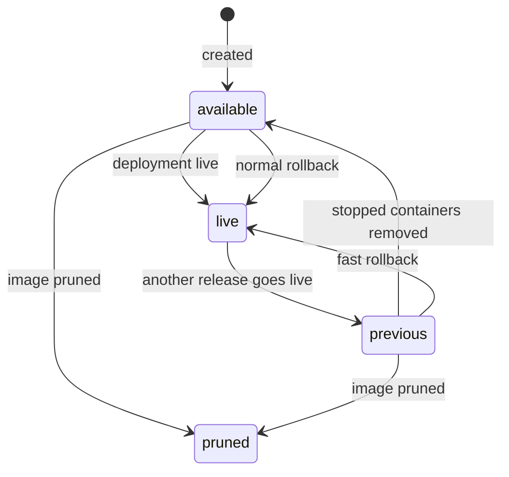

# F02 – One-click rollback and release history — Gap 2

## Summary

Every deploy creates an immutable Release. The user sees the history and can return to any retained Release with one click. A rollback never rebuilds. When the old containers are still present, it is instant. Engine details: [08](../08-deploy-engine.md#9-rollback).

## User stories

- **US-REL-01** As a developer, I see all releases of a service with commit, author, time, status and who deployed.
- **US-REL-02** As a developer, I click "Roll back" on the previous release and traffic returns in seconds.
- **US-REL-03** As a developer, I compare two releases (config, variables names, image, commit).
- **US-REL-04** As an admin, I set how many releases and images are kept.
- **US-REL-05** As a developer, I add a note to a release.

## Rules

- **REQ-REL-001** (MUST) Each deploy creates one Release with a per-service number (`v1`, `v2`, …). A Release has: image digest, config snapshot, variable snapshot, secret version numbers, source (commit, PR, promoted-from, rollback-of), actor, time, note.
- **REQ-REL-002** (MUST) A Release row is immutable except `pruned_at`. The user note is stored in the table `release_annotations` ([03-data-model](../03-data-model.md)), changed by `PATCH /releases/{id}`, and audited.
- **REQ-REL-003** (MUST) Rollback creates a new Deployment with `trigger = rollback` that targets an older Release. It never builds. It reuses the image digest.
- **REQ-REL-004** (MUST) Fast rollback: if the target's stopped containers still exist (`retain_stopped`), they are started, health checked and switched. Target time `fast_rollback_target`.
- **REQ-REL-005** (MUST) A rollback restores the Release's image, command, ports, resources, health check, strategy options, plain variables and secret versions. It does NOT restore domains, volumes, placement or replica count (these are live settings, and a rollback must not change data or routing setup). The UI lists what is and is not restored before confirm.
- **REQ-REL-006** (MUST) The retention of Releases and images is `retain_releases` (default 10). Older images are pruned from the registry. Their Release rows stay in history with `pruned_at` set and the rollback button disabled with the reason.
- **REQ-REL-007** (MUST) The release list shows for each Release: state of the last Deployment, whether it is live, whether a fast rollback is possible.
- **REQ-REL-008** (MUST) A rollback to a Release whose secret version was destroyed is refused before anything starts (409 `secret_version_destroyed`).
- **REQ-REL-009** (SHOULD) Release diff: `GET /releases/{a}/diff/{b}` returns changes of config, variable names and values (values of plain variables only), secret versions, image digest and commit.
- **REQ-REL-010** (MUST) Rolling back on a protected environment needs `admin` or higher ([10](../10-security.md#3-roles-and-permissions)).
- **REQ-REL-011** (SHOULD) Auto-rollback: a Deployment that fails its post-switch check rolls back automatically ([REQ-DEPLOY-110](../08-deploy-engine.md#requirements)).
- **REQ-REL-012** (MUST) The current live Release cannot be rolled back to itself (409 `already_live`).

## States

A Release has no state of its own. It is `live` (referenced by `services.live_release_id`), `previous` (kept stopped containers exist), `available` (image kept), or `pruned`.

## Edge cases

- Rollback while a deploy is active: the rollback is queued like any deploy (superseding older queued ones).
- Database changed since: data is not rolled back. The UI says so on the confirm dialog.
- Rolled back to v7 and then a new deploy: the new Release is v13 (numbers never reuse).
- Registry unreachable: normal rollback fails at pull with `image_pull_failed`. Fast rollback still works (container already on the node).
- Node of the old containers was replaced: fast rollback is not available, a normal rollback runs.
- Service config changed after v7 (new port): rollback restores the old port (REQ-REL-005). If the live domain points to a port that the old Release does not expose, the response warns `domain_port_mismatch` and refuses unless `force: true`.

## Touch points

API: `/services/{id}/releases`, `/releases/{id}`, `POST /services/{id}/rollback` (body: `release_id`), `/releases/{a}/diff/{b}`. CLI: `polipan release ls|diff`, `polipan rollback <release>`. UI: Deployments tab with "Roll back" button.

## Acceptance criteria

- **AC-REL-01** Given 3 releases, When the user rolls back to v2 with one click, Then a Deployment with `trigger = rollback` goes `live` and the service runs the digest of v2. (REQ-REL-003)
- **AC-REL-02** Given v2's stopped containers exist, When the user rolls back, Then traffic switches in under `fast_rollback_target` and no image pull happens. (REQ-REL-004)
- **AC-REL-03** Given v1's image was pruned, When the user opens the list, Then v1 shows `pruned` and rollback is disabled with a reason. (REQ-REL-006)
- **AC-REL-04** Given a rollback, When done, Then no build job ran. (REQ-REL-003)
- **AC-REL-05** Given a rollback to v2, When done, Then domains, volumes and replica count are unchanged and variables are those of v2. (REQ-REL-005)
- **AC-REL-06** Given a developer on a protected environment, When they roll back, Then 403. (REQ-REL-010)
- **AC-REL-07** Given the live Release, When the user rolls back to it, Then 409 `already_live`. (REQ-REL-012)
- **AC-REL-08** Given a Release that used a destroyed secret version, When rolling back to it, Then 409 `secret_version_destroyed` and nothing started. (REQ-REL-008)

## Out of scope

Rolling back database data (see [F10](F10-backups-and-restore-checks.md) for restore). Scheduled/automatic rollbacks by time.
