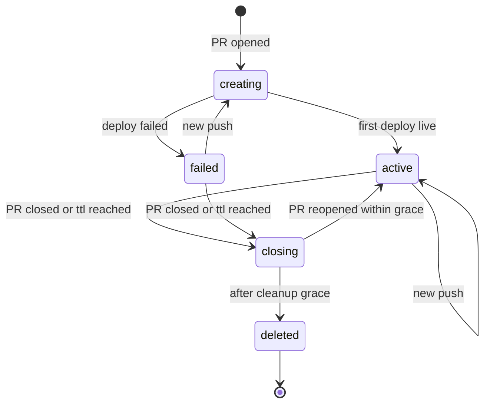

# F03 – Preview environments for every pull request — Gap 3

## Summary

When a pull request is opened or updated, Polipan builds it and deploys it into a short-lived preview environment with its own URL. It posts the URL on the pull request. When the PR closes, the environment is deleted. Previews cannot read production secrets.

## User stories

- **US-PREV-01** As a developer, I open a PR and get a working URL as a comment on the PR.
- **US-PREV-02** As a reviewer, I click the URL and test the change.
- **US-PREV-03** As an admin, I limit how many previews exist and how long they live.
- **US-PREV-04** As an admin, I am sure that PR code cannot read production secrets.
- **US-PREV-05** As a developer, I see and delete previews in the UI.

## Rules

- **REQ-PREV-001** (MUST) Providers: GitHub (GitHub App, first), GitLab and Gitea/Forgejo (webhooks). Events handled: PR `opened`, `reopened`, `synchronize` (new push), `closed`/`merged`, and label changes if label gating is on.
- **REQ-PREV-002** (MUST) Enabling previews is a project setting (`previews.enabled`) plus a base environment (default: the environment of kind `staging`, else `production`). The base environment's services are the **template** of the preview.
- **REQ-PREV-003** (MUST) On PR opened: create environment `pr-<n>` (kind `preview`, `preview_repo`, `preview_pr_number`, `base_env_id`), clone the base environment's services and config (not data), build the PR commit for services that track the PR's repo, deploy others from the base environment's live Release (same digest).
- **REQ-PREV-004** (MUST) On a new push to the PR: build the new commit and deploy to the existing preview with the `recreate` strategy by default (`blue_green` allowed by setting).
- **REQ-PREV-005** (MUST) URL pattern: `pr-<n>-<service>.<preview_domain>` (one label, so one `*.<preview_domain>` wildcard certificate covers it), where `preview_domain` is an org setting (for example `preview.example.com`). The label is at most 63 chars: a longer service name is cut and gets a 4-char hash. It uses the wildcard certificate if a DNS-01 provider is set, else one certificate per host.
- **REQ-PREV-006** (MUST) After the first successful deploy and after each later one, Polipan posts or updates one comment and one commit status on the PR with the URL and state (`pending`, `success`, `failure`).
- **REQ-PREV-007** (MUST) On PR closed or merged: after `preview_cleanup_grace`, delete the environment, its containers, volumes, domains, and its images beyond the retention. Audit event `preview.deleted`.
- **REQ-PREV-008** (MUST) Limits: `preview_max_active` per project (new PR beyond the limit gets status `failure` with the reason, and no environment), `preview_ttl` since the last push (then the environment is deleted and the PR gets a comment).
- **REQ-PREV-009** (MUST) PRs from forks create no preview unless `preview_from_forks` is on. When on, the preview gets no secrets at all (only `preview = true` **variables**, never secrets) and requires a maintainer's label `polipan-preview` before it builds.
- **REQ-PREV-010** (MUST) A preview resolves only variables and secrets with `preview = true`. All others are not resolved and not sent to the node. A required name that is missing makes the preview deployment fail with a message listing the names.
- **REQ-PREV-011** (MUST) Databases in previews: each preview gets its own empty database service (from the base environment's database service config), never a connection to the base environment's database. An optional `previews.seed` command (one-off) can load seed data. Restoring data copies from production is not offered in v1.
- **REQ-PREV-012** (MUST) Preview environments have `protected = false` and are exempt from approvals. Their actor is `system`.
- **REQ-PREV-013** (SHOULD) Previews can be placed on nodes with label `preview=true` (setting `previews.node_selector`) so PR code runs away from production nodes.
- **REQ-PREV-014** (MUST) Manual: a user can create a preview for a branch or PR number and delete any preview from the UI/API/CLI (`preview:manage`).

## States

The state is stored in the environment's `settings` (`preview_state`) and shown in the UI.

## Edge cases

- Many pushes in a row: the engine supersedes queued builds ([08](../08-deploy-engine.md#10-concurrency-and-queue)).
- PR targets a different base branch than the one the base environment tracks: allowed. The base environment is only the config template.
- Project config lists a service with a domain that has a fixed hostname: in previews it is replaced by the preview URL pattern. Fixed hostnames are never copied.
- PR reopened within grace: the environment returns to `active` (no cleanup).
- Webhook delivered twice: de-duplicated by delivery id.
- Out of capacity: the preview deployment fails with `node_unavailable`, status posted to the PR.
- Preview uses OAuth callbacks with fixed URLs: outside Polipan's control. Docs tell the user to use wildcard callback support.

## Touch points

API: `/projects/{id}/previews`, `DELETE /environments/{id}` (preview kind), `/webhooks/git/{webhook_id}`. CLI: `polipan preview ls|create|rm`. Config: `previews:` block in [07](../07-config-as-code.md). UI: Project → Previews.

## Acceptance criteria

- **AC-PREV-01** Given previews enabled, When a PR opens, Then environment `pr-<n>` exists, deploys, and the PR has a comment with a working HTTPS URL. (REQ-PREV-002, REQ-PREV-003, REQ-PREV-005, REQ-PREV-006)
- **AC-PREV-02** Given an active preview, When a new commit is pushed, Then the URL serves the new commit and the same comment is updated. (REQ-PREV-004, REQ-PREV-006)
- **AC-PREV-03** Given a closed PR, When `preview_cleanup_grace` passes, Then the environment, containers, volumes and domains are gone. (REQ-PREV-007)
- **AC-PREV-04** Given a production secret `DB_PASSWORD` without `preview = true`, When a preview runs, Then the container has no `DB_PASSWORD`. (REQ-PREV-010)
- **AC-PREV-05** Given a PR from a fork and default settings, When opened, Then no environment is created. (REQ-PREV-009)
- **AC-PREV-06** Given `preview_max_active = 10` and 10 active previews, When an 11th PR opens, Then no environment is created and the PR status is `failure` with a reason. (REQ-PREV-008)
- **AC-PREV-07** Given a preview, When it is created, Then its database is a new empty service, not the base database. (REQ-PREV-011)
- **AC-PREV-08** Given no push for `preview_ttl`, When the TTL passes, Then the preview is deleted and the PR gets a comment. (REQ-PREV-008)

## Out of scope

Copying production data into previews. Visual regression tooling. Previews of Docker-image-only services without a PR (use a custom environment).
