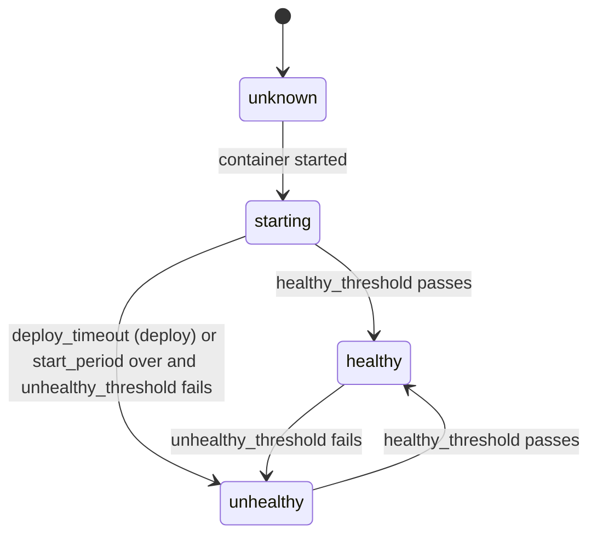

# F05 – Health checks before switching traffic — Gap 5

## Summary

Polipan runs health checks on new containers before they get traffic. Checks run in the agent (not Docker `HEALTHCHECK`), so the deploy engine gets results at once. The same checks keep running while the service is live and feed alerts and failover. Engine use: [08](../08-deploy-engine.md#4-common-steps).

## User stories

- **US-HC-01** As a developer, I set an HTTP path that must return 200 before traffic switches.
- **US-HC-02** As a developer, I get a safe default (TCP on the port) without configuring anything.
- **US-HC-03** As a developer, I see why a deploy failed: the last health error and response.
- **US-HC-04** As an operator, I get an alert when a live service turns unhealthy.

## Rules

- **REQ-HC-001** (MUST) Check types: `http` (`path`, `port`, optional `host` header, `expected_status` range, default 200–399), `tcp` (`port`), `command` (exec in the container, success = exit 0).
- **REQ-HC-002** (MUST) Parameters and defaults come from the [glossary](../01-glossary.md#defaults): `interval`, `timeout`, `healthy_threshold`, `unhealthy_threshold`, `start_period`, `deploy_timeout`.
- **REQ-HC-003** (MUST) If no check is set and the service has a port, a `tcp` check on the first port is used. A service without ports and without a check is `healthy` when the container is running for `start_period` without restart.
- **REQ-HC-004** (MUST) During `start_period`, failures do not count towards `unhealthy_threshold`, but a pass counts towards `healthy_threshold` (so a fast service is ready early).
- **REQ-HC-005** (MUST) A green replica is healthy after `healthy_threshold` consecutive passes. All replicas must be healthy together, within `deploy_timeout`, before the switch ([REQ-DEPLOY-003](F01-zero-downtime-deploy.md#rules)).
- **REQ-HC-006** (MUST) HTTP checks go to the container IP and port directly (not through Caddy), with a 3 s default timeout, and do not follow redirects. The response status and the first 1 KiB of the body (for error display) are stored in the last result.
- **REQ-HC-007** (MUST) After `live`, checks keep running. A replica that fails `unhealthy_threshold` times is `unhealthy`: the server removes it from the ingress upstreams (new desired state) and the agent restarts the container if `restart_on_unhealthy` is true (default true, with back-off 10 s, 30 s, 60 s, max 5 min). It rejoins when healthy again.
- **REQ-HC-008** (MUST) If all replicas of a live service are unhealthy, Caddy keeps routing to them (a bad answer is better than none) and alert `service_unhealthy` (critical) fires.
- **REQ-HC-009** (MUST) Health results are reported by `HealthReport` messages on change (not every check) and stored as `placements.health`. The UI shows state, consecutive counters and the last error.
- **REQ-HC-010** (SHOULD) The Release snapshot contains the check config, so a rollback restores the old check.
- **REQ-HC-011** (SHOULD) The UI offers "test health check" against the live service, with the result and response status.
- **REQ-HC-012** (MUST) A check with `command` type runs without a TTY, with a timeout, and output truncated to 1 KiB.

## States

## Edge cases

- App listens on `localhost` only inside the container: TCP check fails. The failure message hints at binding to `0.0.0.0`.
- Slow startup (more than `deploy_timeout`): user raises `start_period` and `deploy_timeout`.
- Health endpoint needs a DB that is down: all replicas unhealthy, REQ-HC-008 applies. The docs advise a shallow check path.
- Check flaps: counters make a single failure not matter. An alert needs `for` time ([F09](F09-alerts-metrics-logs.md)).
- Canary: health of green is part of the gate every step ([08](../08-deploy-engine.md#6-canary)).
- Worker without port: use `command` check or none.

## Touch points

API: `services.<id>.config.health` via service endpoints, `POST /services/{id}/health-check:test`. CLI: `polipan service health-test`. Config: `services.<name>.healthcheck` ([07](../07-config-as-code.md)). UI: Service settings → Health check.

## Acceptance criteria

- **AC-HC-01** Given an HTTP check on `/ready` that returns 503 for 20 s then 200, When deploying blue-green, Then traffic switches only after three 200s. (REQ-HC-001, REQ-HC-005)
- **AC-HC-02** Given no check and a port, When deployed, Then a TCP check is used and shown in the UI. (REQ-HC-003)
- **AC-HC-03** Given a live replica that returns 500, When `unhealthy_threshold` fails happen, Then it is removed from the ingress upstreams and an alert fires. (REQ-HC-007)
- **AC-HC-04** Given every replica unhealthy, When requests arrive, Then Caddy still routes to them and the alert is `critical`. (REQ-HC-008)
- **AC-HC-05** Given a failing check at deploy time, When `deploy_timeout` ends, Then the deployment shows the last status and body excerpt. (REQ-HC-006, REQ-HC-009)
- **AC-HC-06** Given failures only inside `start_period`, When it ends with passes, Then the replica is `healthy`. (REQ-HC-004)

## Out of scope

External uptime probes from other regions. Custom gRPC health protocol (use `tcp` or `command` in v1).
