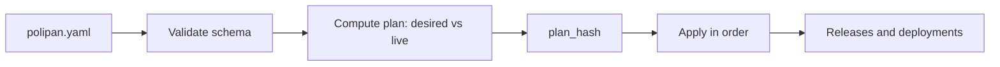

# 07 – Config as Code (`polipan.yaml`)

The file format is defined by [schemas/polipan.schema.json](schemas/polipan.schema.json) (JSON Schema 2020-12). Rules and acceptance criteria: [F08](04-features/F08-config-as-code-api-cli-terraform.md). This file explains meaning, sync and mapping, and gives examples.

## 1. Where the file lives

- In the app repository, at the root: `polipan.yaml` (alternatives: `.polipan.yaml`, `polipan.yml`). The path is set in the project (`config_source.path`).
- One file describes **one project**. The key `project` must equal the project slug.
- Sync starts on a push to the tracked branch (Git webhook, [05-api](05-api.md#5-webhooks-in)) or on `polipan apply`.

## 2. Top-level keys

| Key | Meaning |
|---|---|
| `version` | Always `1`. |
| `project` | Project slug. |
| `environments` | Optional. Per environment: `kind`, `protected`, `auto_deploy`, default `deploy` options, extra `variables` and `secrets`, and `services.<name>` overrides. |
| `services` | Required. The services, applied to every environment that exists (minus `enabled: false` overrides). |
| `variables` | Project-wide shared plain variables. |
| `secrets` | Names of project secrets that must exist. No values. |
| `previews` | Preview environment settings ([F03](04-features/F03-preview-environments.md)). |
| `backup_targets` | Backup targets by name (credentials via secret name). |
| `alerts` | Alert channels and rules ([F09](04-features/F09-alerts-metrics-logs.md)). |

## 3. Resolution order for a service in one environment

1. `services.<name>` (base).
2. `environments.<env>.deploy` (defaults for all services of that environment, merged into `deploy`).
3. `environments.<env>.services.<name>` (override). Only the fields in the schema `serviceOverride` are allowed. Lists (`domains`, `volumes`) in an override **replace** the base list. Maps (`env`) are **merged** key by key.

Anything not set in the file keeps the value it has in the UI/API (not managed by git). A field set by the file is `git_managed` ([REQ-CAC-005](04-features/F08-config-as-code-api-cli-terraform.md#config-as-code)).

## 4. Units and mapping to API

| In file | In API / snapshot |
|---|---|
| `cpu: "500m"` or `0.5` | `cpu_limit_millis: 500` |
| `memory: "512Mi"` | `memory_limit_bytes: 536870912` |
| Durations `30s`, `5m`, `7d` | integer seconds with suffix `_seconds` |
| `ports: [3000]` | `ports: [{container: 3000, protocol: tcp}]` |
| `secrets: [NAME]` | secret refs (names). The values come from the secrets store. |
| `env` values | plain variables with `git_managed = true`. Env `preview: true` is the per-value flag. |

The service config stored in a Release (`config_snapshot`) is the same document after merging, converting units and filling defaults.

## 5. Variables and secrets in the file

- Plain values are allowed in `env` and `variables`.
- Secrets are only **named** (`secrets:`). Apply fails with `missing_secret` if a name does not exist yet. Values are set with the UI, `polipan secret set` or Terraform.
- References `${{NAME}}` and `${{db.<service>.<FIELD>}}` work in values ([C05](04-features/C05-env-vars.md)). There is no other templating, no expressions and no includes.

## 6. Plan and apply



- **Validate:** JSON Schema, then semantic checks (unknown service in `depends_on`, domain conflicts, port not exposed, strategy not allowed for volumes, unknown backup target). Errors give `line`, `path`, `message`.
- **Plan:** for each resource: `create`, `update` (field list), `delete` (only with `prune`), `unmanaged` (exists, not in the file). The plan hash covers the file content and the live state version.
- **Apply order:** environments → variables → secrets (existence check) → volumes → services → domains → backup targets and policies → alerts. Service changes that affect a Release create a Deployment (`trigger = config_apply`). Domain, replica and alert changes apply directly.
- **Drift:** a change made by hand with `override_git: true` marks the project `drifted`. The next apply reverts the field to the file value, and the plan shows it.
- **Rename:** not automatic. A new name is a create, the old name is `unmanaged` (or deleted with `prune`).

## 7. Templates

Templates (C03) use [schemas/template.schema.json](schemas/template.schema.json). The `services` entries have the same shape as `services` in `polipan.yaml`. Inside templates, `${{inputs.NAME}}` reads an input and `${{services.NAME.FIELD}}` reads another service of the same template.

## 8. Examples

### 8.1 Simple app from Git

```yaml
version: 1
project: blog
services:
  web:
    source:
      git:
        repo: acme/blog
        branch: main
        builder: railpack
    ports: [3000]
    domains:
      - host: blog.example.com
        port: 3000
    healthcheck:
      type: http
      path: /healthz
    resources:
      cpu: "500m"
      memory: 512Mi
```

### 8.2 App with Postgres, blue-green, backup and restore check

```yaml
version: 1
project: shop
environments:
  production:
    kind: production
    protected: true
    deploy:
      strategy: blue_green
      drain_seconds: 30
  staging:
    kind: staging
backup_targets:
  - name: offsite
    kind: b2
    config: { bucket: acme-backups, path: shop }
    credentials_secret: B2_CREDENTIALS
services:
  db:
    type: database
    db: { engine: postgres, version: "16" }
    volumes:
      - { name: data, path: /var/lib/postgresql/data }
    backup:
      schedule: "0 2 * * *"
      targets: [offsite]
      retention: { keep_daily: 7, keep_weekly: 4, keep_monthly: 6 }
      restore_check: { enabled: true, schedule: "0 3 * * 0" }
  api:
    source:
      git: { repo: acme/shop, branch: main, builder: dockerfile }
    ports: [8080]
    env:
      LOG_LEVEL: info
      DATABASE_URL: "${{db.db.URL}}"
    secrets: [SESSION_KEY]
    healthcheck: { type: http, path: /ready, port: 8080 }
    deploy:
      pre_deploy: ["./migrate", "up"]
    depends_on: [db]
    replicas: 2
    failover: auto
```

### 8.3 Canary in production, previews, per-environment domains

```yaml
version: 1
project: shop
previews:
  enabled: true
  base_environment: staging
  max_active: 10
  ttl: 7d
  node_selector: { preview: "true" }
environments:
  production:
    kind: production
    protected: true
    services:
      api:
        domains:
          - { host: api.shop.example.com, port: 8080 }
        replicas: 3
        deploy:
          strategy: canary
          canary:
            steps: [10, 25, 50, 100]
            step_interval: 5m
            max_5xx_rate: 0.02
            max_p95_ratio: 1.5
  staging:
    kind: staging
    services:
      api:
        domains:
          - { host: api.staging.shop.example.com, port: 8080 }
services:
  api:
    source:
      git: { repo: acme/shop, branch: main, builder: railpack }
    ports: [8080]
    healthcheck: { type: http, path: /ready }
    env:
      LOG_LEVEL: { value: debug, preview: true }
    secrets:
      - SESSION_KEY
      - { name: SENTRY_DSN, preview: true }
```

## Requirements

- **REQ-CAC-100** (MUST) The server validates every file with the embedded `polipan.schema.json` and then runs the semantic checks of section 6. Both the server and the CLI (`polipan validate`) use the same schema file.
- **REQ-CAC-101** (MUST) Merge order and list/map rules of section 3 are implemented exactly. A unit test per rule exists.
- **REQ-CAC-102** (MUST) The plan hash changes when the file or the live state version changes.
- **REQ-CAC-103** (MUST) The three examples in section 8 validate against the schema in CI. A fourth CI fixture with an unknown key MUST fail validation with a line and field in the error.
- **REQ-CAC-104** (MUST) Apply is not atomic across resources, but each resource change is atomic. The result lists per resource `applied`, `skipped` or `failed`. A failed resource stops later resources that depend on it.
