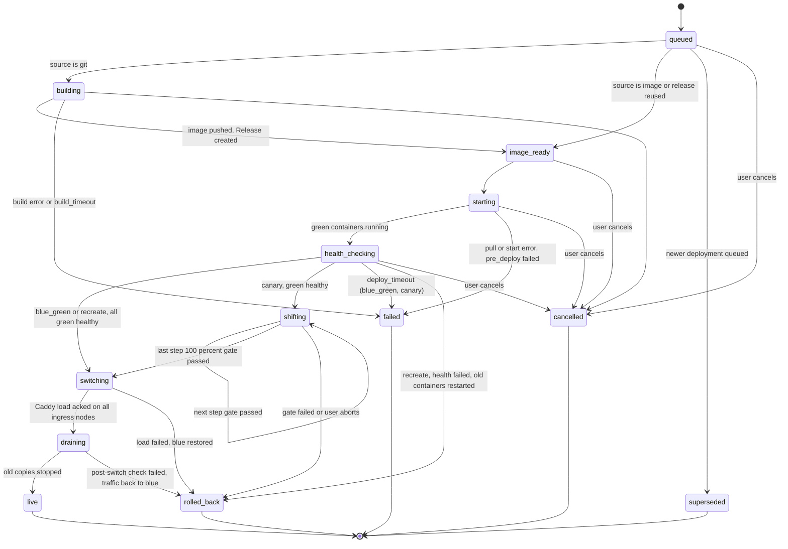

# 08 – Deploy Engine

This file is the exact behaviour of a Deployment. User view and acceptance criteria: [F01](04-features/F01-zero-downtime-deploy.md), [F02](04-features/F02-rollback-and-releases.md), [F05](04-features/F05-health-checks.md). Defaults: [glossary](01-glossary.md#defaults). Tables: [03-data-model](03-data-model.md).

## 1. Concepts

- A **Release** is created before any container starts (after the build). It points to an image **digest**. A switch of traffic is a change of which Release's containers are the upstream. The image address stays the same for a Release forever.
- A **Deployment** moves one Release to `live` using one **strategy**.
- Deployments run as queue jobs on the server. Container work is done by commands to the agent ([09-multi-server](09-multi-server.md)).
- The server decides. The agent executes commands and reports. Every command has a `command_id` and is idempotent.

## 2. State machine

Rules for states:

- `queued`, `building`, `image_ready` do not touch running containers.
- For `blue_green` and `canary`, from `starting` on, blue (the previous live Release) keeps serving until `switching` is acked. For `recreate` blue is stopped first (section 7), so there is a downtime.
- The post-switch check (section 5.4) runs during the first part of `draining`. If it fails, blue is still not stopped, so the state goes `draining → rolled_back`.
- `failed` and `rolled_back` always leave the previous Release live and serving. If there is no previous Release, the service has no live Release and the state is shown as "no live release".
- Terminal states: `live`, `failed`, `rolled_back`, `cancelled`, `superseded`.
- Every transition writes a `deployment_steps` row and an `events` row, and (for the user actions) an audit event.
- `failure_reason` codes: `build_failed`, `build_timeout`, `image_pull_failed`, `pre_deploy_failed`, `container_start_failed`, `health_timeout`, `health_failed`, `gate_5xx`, `gate_latency`, `switch_failed`, `node_unavailable`, `cancelled_by_user`, `superseded`, `internal_error`.

## 3. Strategy selection

1. If the request names a strategy, use it (after the checks below).
2. Else use the service setting. If not set, use `deploy_strategy` default from the [glossary](01-glossary.md#defaults).
3. **Forced recreate** (with a warning in the response and the UI) when any of these is true:
   - the service has a volume with `access_mode = single_writer` (for example every database);
   - the service type is `database`;
   - the service has no ingress domain and no exposed port (workers and cron use `recreate`, see section 8), unless it is a worker with `allow_overlap: true`;
   - the service has a host port binding.
4. `blue_green` and `canary` need: at least one healthy-checkable port (or a `command` health check), and no single-writer volume.
5. `canary` needs a domain, because the traffic split happens in Caddy. One blue and one green replica are enough: weights are per upstream.

## 4. Common steps

1. **Create Release** (after build, or reuse for rollback and promotion). Resolve variables and secret versions ([03-data-model](03-data-model.md#4-variable-and-secret-resolution)).
2. **Choose nodes.** The scheduler picks nodes for each replica: labels and constraints, then free CPU and RAM, then spread across nodes. For a deploy of an existing service the default is to keep the same nodes as blue.
3. **Pre-deploy command** (optional `pre_deploy`): run once in a one-off container from the new image, on one node, with the new Release's env. Exit code ≠ 0 → `failed` / `pre_deploy_failed`. Timeout: `deploy_timeout`.
4. **Pull** the digest on each chosen node (the agent pulls from the registry over the mesh).
5. **Start green** containers named `<service>-<release_short>-<replica>` with labels `polipan.color=green`. They join `polipan0` with a private alias that differs from the live alias. They get no public traffic.
6. **Health check green** (agent-side, see [F05](04-features/F05-health-checks.md)). All replicas must be healthy at the same time, within `deploy_timeout`.
7. **Switch** (per strategy, section 5, 6, 7).
8. **Drain and stop blue**: wait `drain_seconds`, send SIGTERM with the service `stop_grace_period` (default 30 s), then stop. Containers are stopped but kept, up to `retain_stopped` sets.
9. **Finalize**: set `services.live_release_id`, `placements` roles, `deployments.state = live`, prune old Releases' images beyond `retain_releases`.

## 5. Blue-green

1. Steps 1–6 of section 4.
2. **Switch.** The server sends `SwitchTraffic(service, release, weights = {green: 100, blue: 0})` to every ingress node of the service's domains. Each agent builds the complete Caddy JSON from its desired state and sends **one** `POST /load`. Caddy applies a config atomically and without dropping connections. The agent acks with the config hash.
3. The switch is complete only when **all** ingress nodes acked. If any ingress node does not ack in 30 s: send a `SwitchTraffic` back to blue on the nodes that acked, state `rolled_back`, reason `switch_failed`. Nodes that are `down` are skipped (they get the new config on reconnect, from desired state).
4. After the ack, the server runs a **post-switch check**: for 15 s the agent probes the public route on each ingress node. If the failure rate is over `canary_max_5xx_rate`, the server rolls back (same as a normal rollback to blue, fast path).
5. Go to `draining`. The post-switch check runs at the start of `draining`, while blue is still running (blue is stopped only after `drain_seconds`, and the check window is shorter). A failed check sends traffic back to blue: `draining → rolled_back`.

Why this is "pointing to another image address": the Release's `image_ref` is an immutable digest. Green runs that digest. The switch only moves Caddy's upstream from the blue containers to the green ones.

## 6. Canary

1. Steps 1–6 of section 4.
2. For each percent `p` in `canary_steps` (default [10, 25, 50, 100]):
   1. Send `SwitchTraffic` with weights `{green: p, blue: 100 - p}`. Caddy uses `weighted_round_robin` over the upstream list, repeating upstreams in proportion to weights.
   2. State is `shifting`, `canary_step = p`. Wait `canary_step_interval` (not for 100 %, which goes straight to `switching`).
   3. **Gate**, evaluated at the end of the interval from Caddy metrics in VictoriaMetrics for the interval window:
      - green health checks still pass;
      - green 5xx rate ≤ `canary_max_5xx_rate` (needs at least 20 green requests in the window. With fewer, the gate passes on health only and the step interval is extended once by the same time);
      - green p95 latency ≤ blue p95 × `canary_max_p95_ratio`.
   4. Gate fails → send weights `{blue: 100}`, state `rolled_back`, reason `gate_5xx` or `gate_latency` or `health_failed`.
3. At 100 %: state `switching` (blue gets weight 0), then `draining`.
4. **Manual control:** `promote` skips the wait of the current step. `abort` rolls back at once. `pause` stops the timer (state stays `shifting`). A paused canary is cancelled after 24 h (rolled back).
5. Sticky sessions are not provided. A user can see both versions between requests. The spec for apps: the new and old version MUST both work with the same database.

## 7. Recreate

1. Steps 1–5 of section 4, but the old containers are stopped **first**, then new ones start (needed for single-writer volumes).
2. Health check as in section 4.6. If it fails: stop the new, start the old (blue) again from retained containers, state `rolled_back`.
3. There is downtime from the stop of old until health passes. The UI shows "downtime expected" before the user confirms. No zero-downtime promise.

## 8. Workers and cron

- `worker` (no ingress): `recreate` by default. `blue_green` is allowed if the worker is safe to run twice for `drain_seconds` (the user sets `allow_overlap: true`). Health check type `command` or `tcp` is optional.
- `cron`: a deploy only replaces the stored Release. The next schedule uses it. A running job is not killed.

## 9. Rollback

- Rollback = a new Deployment with `trigger = rollback`, `release_id` = an older Release, run through the **same strategy** as any deploy, with `source.rollback_of_release_id` set. No build.
- **Fast rollback:** if the target Release's stopped containers still exist on their nodes (`retain_stopped`) and the image is not pruned: the agent starts them (`docker start`), health check runs, then `SwitchTraffic`. Target: `fast_rollback_target`. Strategy for a fast rollback is always `blue_green` (or `recreate` if forced). A canary rollback may use `canary` only if the user asks.
- **Normal rollback:** pull the image by digest, then continue as a normal deploy.
- If the image was pruned (`pruned_at` set) the rollback is refused with 409 `release_image_pruned` unless the build can be repeated from the commit (the user can start a normal deploy from that commit).
- A rollback also restores plain variables and secret **versions** of that Release. Secret versions that were destroyed make the rollback fail with 409 `secret_version_destroyed` before anything starts.
- Database data is **not** rolled back. The UI says so.

## 10. Concurrency and queue

- One active Deployment per service ([03-data-model](03-data-model.md)).
- A new request while one is active: it is stored `queued`. A newer request replaces older `queued` ones (older → `superseded`). It starts when the active one reaches a terminal state.
- The user can cancel an active Deployment up to and including `health_checking`. In `shifting` it means abort (rollback). In `switching` and `draining` cancel is refused (409 `deployment_not_cancellable`): finish first, then roll back.
- Many services deploy in parallel. Per-node limit: 2 builds and 4 concurrent starts (server config).

## 11. Failure and recovery

- Server crash during a Deployment: on start, the server reads active Deployments and resumes from `state`. Steps are idempotent by `command_id`.
- Agent offline during `starting` or `health_checking`: wait up to 60 s (`node_down_after`), then `failed` / `node_unavailable`, blue untouched.
- Agent offline during `switching`: see section 5.3.
- Green containers of a failed Deployment are removed after 10 minutes (kept for log reading).
- The Caddy config is always generated from the **desired state** of the node, so a restart of Caddy or the agent returns to the last switched state.

## 12. Data and migrations

- `pre_deploy` is the place for DB migrations. Rule: a migration MUST work with the old code and the new code at the same time (expand/contract). Polipan cannot verify this. The UI shows a warning text on services that have `pre_deploy` and use blue-green or canary. Rollback does not undo migrations.

## 13. Events and progress

SSE stream `GET /api/v1/deployments/{id}/events` sends each state change, health result and log line. The UI and CLI (`polipan deploy --follow`) use it.

## Requirements

- **REQ-DEPLOY-100** (MUST) The Deployment state machine in section 2 is the only allowed set of states and transitions.
- **REQ-DEPLOY-101** (MUST) In `blue_green` and `canary`, blue (the previous live Release) is never stopped before the switch is acked by all reachable ingress nodes. `recreate` stops blue first by design.
- **REQ-DEPLOY-102** (MUST) The traffic switch is one atomic Caddy `POST /load` per ingress node, generated from the full desired state.
- **REQ-DEPLOY-103** (MUST) A Release stores an image digest. Rollback and promotion never build.
- **REQ-DEPLOY-104** (MUST) Forced recreate applies in the cases of section 3.3, and the response contains a `warnings` entry with code `zero_downtime_not_available`.
- **REQ-DEPLOY-105** (MUST) A canary step passes only when the gates of section 6.2.3 pass.
- **REQ-DEPLOY-106** (MUST) A failed or rolled back Deployment leaves the previous Release live.
- **REQ-DEPLOY-107** (MUST) After a server restart, active Deployments resume or fail cleanly. None stay stuck.
- **REQ-DEPLOY-108** (MUST) Rollback restores the variables and secret versions of the target Release.
- **REQ-DEPLOY-109** (MUST) `pre_deploy` runs once, before green starts, and a failure stops the Deployment.
- **REQ-DEPLOY-110** (SHOULD) A post-switch check of 15 s runs and triggers an automatic rollback on failure (section 5.4).
- **REQ-DEPLOY-111** (MUST) Deploy progress is available as an SSE stream.
