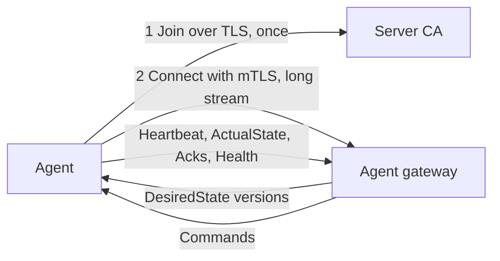
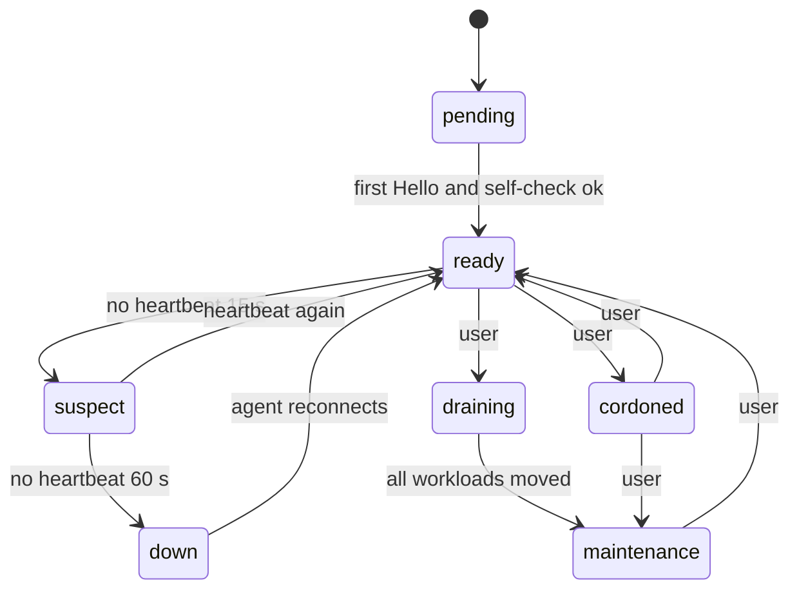
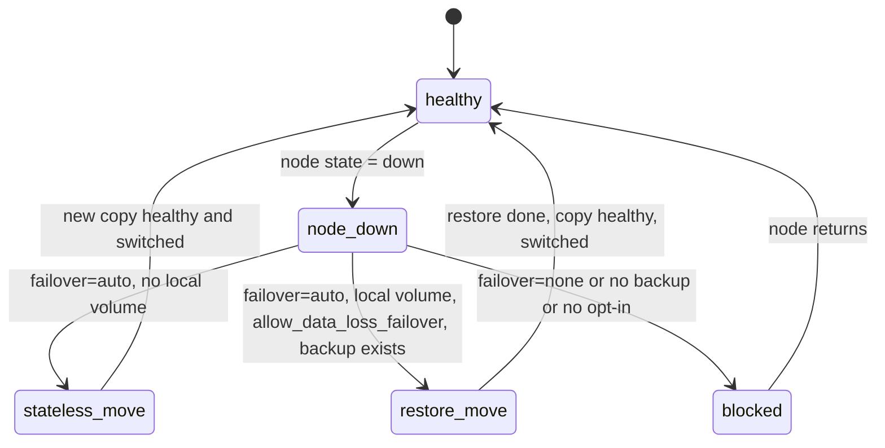

# 09 – Multi-Server and Agent Protocol

User view and acceptance criteria: [F06](04-features/F06-multi-server-failover.md). Message schema: [schemas/agent.proto](schemas/agent.proto). Defaults: [glossary](01-glossary.md#defaults).

## 1. Model

- One control plane, many nodes. Every node (including the control-plane host) runs `polipan-agent`, Docker and Caddy.
- The agent **dials out** to `agent_grpc_port`. Worker nodes need no inbound port except 80/443 (if ingress) and the WireGuard UDP port.
- The server keeps a **desired state** document per node with a strictly increasing `version`. The agent applies it and reports the **actual state**. Deploy steps that need an answer are **commands** with `command_id` and an ack.

## 2. Join flow

1. A user with permission `node:create` runs `polipan node add <name> [--label k=v]` (or uses the UI). The server creates a join token (`join_token_ttl`, single use), stores only its hash in `node_join_tokens`, and shows a one-line command:
   `curl -fsSL https://<server>/install-agent.sh | sh -s -- --server <host>:9443 --token <token>`
2. The script installs Docker (if missing), Caddy (as a container managed by the agent), WireGuard tools and the agent as a systemd service.
3. The agent creates a key pair and calls `AgentJoin.Join` over TLS (server certificate only, verified with the CA fingerprint given in the command). The server checks the token, marks it used, assigns a `mesh_subnet` (/24 from `mesh_cidr`) and signs the client certificate (valid 30 days, subject `nod_<id>`).
4. The agent stores the certificate and opens `Connect` with mTLS. The node state goes `pending → ready` when the first `Hello` and a passing self-check (Docker works, Caddy works, WireGuard up) arrive.
5. The server sends the new peer to all other nodes (desired state with the new `peers`) so the mesh is complete in one reconcile round.

Certificates are renewed over the stream (`CertRenewRequest`) when less than 10 days remain. A revoked node (deleted by a user) has its serial put on the revocation list and the gateway closes its stream.

## 3. The stream

- Message order: agent sends `Hello` → server sends the current `DesiredState` → agent applies and sends `ActualState` → heartbeats and events.
- `Heartbeat` every `heartbeat_interval`. The server also sends `Ping` every 15 s. Missing data for more than the gRPC keepalive (30 s) closes the stream. The agent reconnects with back-off 1 s, 2 s, 4 s … max 30 s, with jitter.
- Only one stream per node is active. A new `Connect` from the same node replaces the old stream.
- Messages are limited to 4 MiB. Log and terminal data are sent as `StreamChunk` of up to 64 KiB.

## 4. Desired state and commands

- **DesiredState** (full document): peers, workloads (the containers this node must run), ingress (Caddy routes), backup jobs, scrape targets. Whenever anything changes for the node, the server increments `desired_state_version` and sends the new document. The agent applies only a higher version.
- **Reconcile:** compare desired and actual: pull missing images, create or start missing containers, stop and remove containers not in desired state (only those with label `polipan.service`), regenerate the Caddy JSON and `POST /load` if its hash changed, sync WireGuard peers. A container that dies is restarted according to `restart_policy`.
- **Domain TLS status:** `ActualState.domains` carries the TLS state of every host of the ingress spec (`pending`, `issued`, `failed`, the last ACME error text and the certificate end). The server stores it in `domains.tls_status`, `tls_error` and `tls_expires_at` ([REQ-DOM-003](04-features/C04-domains-https.md)).
- **Commands** are used when the server must wait for a result: `PullImage`, `StartWorkload`, `CheckHealth`, `ProbeHealth` (one health check run), `ProbeRoute` (the post-switch check: requests to the local ingress, result `{total, failed}`), `SwitchTraffic`, `RunOneOff`, `PruneImages`, backup commands, `ExecSession`, `StreamLogs`. A command is stored in a node queue until acked. On reconnect, unacked commands are re-sent. The agent remembers the last 1000 `command_id` values and answers a repeated one with the stored ack, without running it again.
- A `SwitchTraffic` command carries the new ingress spec **and** the desired state version it belongs to. The agent applies the desired state first, then sends one `POST /load`, then acks with the Caddy config hash.
- `deadline_unix_ms` on each command. After it the agent drops the command and acks `deadline_exceeded`.

### Agent error codes (in `CommandAck.error_code`)

`deadline_exceeded`, `image_pull_failed`, `container_start_failed`, `port_conflict`, `out_of_resources`, `caddy_load_failed`, `docker_unavailable`, `volume_missing`, `unsupported_version`, `internal_error`. Backup jobs add: `container_not_found`, `dump_failed`, `backup_failed`, `hook_failed`, `restore_failed`, `target_test_failed`.

## 5. Offline behaviour

- The agent saves the last accepted `DesiredState` to `/var/lib/polipan-agent/desired.json` (mode 0600). Secret values inside it are sealed with AES-256-GCM, using a node-local key in `/var/lib/polipan-agent/node.key` (mode 0400). This protects backups and copies of the file. It does not protect against root on the node (root can also read container environments).
- When the server is unreachable, the agent keeps running containers, restarts dead ones, keeps Caddy running with its last config (Caddy also persists its autosave config) and renews certificates through Caddy. Health checks keep running and are queued for upload.
- No deploy, move or failover happens while the server is down.

## 6. Node states

| State | Scheduling new workloads | Serves ingress | Notes |
|---|---|---|---|
| `pending` | no | no | joining |
| `ready` | yes | yes if label `ingress=true` | normal |
| `suspect` | no | yes (still routed) | alert `node_suspect` (warning) |
| `down` | no | no (removed from DNS hint list, other ingress nodes drop it as upstream) | alert `node_down` (critical), failover starts |
| `cordoned` | no | yes | existing workloads stay |
| `draining` | no | yes until empty | the server moves workloads off with blue-green deploys |
| `maintenance` | no | no | no workloads expected |

Thresholds: `node_suspect_after`, `node_down_after`.

## 7. Placement and scheduling

- Input: service `placement` (node labels required, node names allowed/denied, `spread: true|false`), replica count, resource requests (CPU, memory), volume locality.
- Algorithm (one function, deterministic): 1) filter nodes in state `ready`; 2) filter by label and name constraints; 3) filter by free capacity (capacity minus sum of limits of placed workloads, reserve 10 % per node); 4) a service with a local volume MUST go to the node of the volume; 5) score = free memory share + free CPU share, with a penalty for each replica of the same service already on the node; 6) pick the best; ties by node name.
- No node fits → the Deployment fails with `node_unavailable` and the message lists the missing capacity or labels.
- **Move a service:** `POST /api/v1/services/{id}/move` with `target_node_id`. It creates a Deployment with `trigger = move`, `target_node_id`, strategy `blue_green` (the same Release starts on the target, health check, switch, drain). For a service with a local volume, a move needs a data copy: stopped service → backup snapshot of the volume restored on the target → start. This path is `recreate` and shows the downtime warning. Volume data is copied through restic using a backup target, or direct node-to-node over the mesh when the user picks "direct copy".

## 8. Ingress with many nodes

- Each Domain has `ingress_node_ids` (null = all `ready` nodes with label `ingress=true`).
- Every ingress node gets a route for the domain. Upstreams are the mesh IPs and ports of the live containers, on any node. A container on the same node uses the local alias.
- If an ingress node is `down`, other ingress nodes keep serving. DNS is the user's job: A/AAAA records to all ingress nodes (round-robin). The UI shows the IPs to use. Automatic DNS is out of scope ([Q-03](15-open-questions.md)).
- TLS: each ingress Caddy gets its own certificate by ACME HTTP-01 or TLS-ALPN-01. Wildcard preview domains need a DNS-01 provider configured in org settings (Cloudflare, Route53, DigitalOcean, Hetzner; Caddy DNS plugins). Without it, preview URLs use per-host certificates.

## 9. Failover

Rules:

1. Failover starts when a node becomes `down` and only for services with `failover = auto`.
2. **Stateless** (no volume): the scheduler picks a new node. A Deployment with `trigger = failover`, strategy `recreate` for single replica or `blue_green` skipping the dead blue (there is nothing to drain). Time target: `failover_target` in the [glossary](01-glossary.md#defaults) (60 s after the node state becomes `down`).
3. **With local volume:** allowed only if `allow_data_loss_failover = true` AND the volume has a backup policy with at least one successful run. The latest snapshot is restored on the new node, then the service starts. The UI and the alert state: "data since <time of last backup> is lost".
4. **Replicas:** a service with ≥ 2 replicas on different nodes keeps serving from the others. Failover then only adds a replacement.
5. When the old node returns: its stale containers (label `polipan.service`, not in desired state) are stopped and removed by reconcile. Their volumes are kept and renamed `<name>-orphan-<date>`. A user can delete them.
6. Split-brain guard: a container of a failed-over service MUST NOT run on the old node after it returns. The server's desired state (without that service) is the authority, and the agent applies it before starting any container on reconnect (it first reads the new desired state, then starts containers).
7. The server never fails over when **it cannot reach any other node** (it assumes its own network is the problem). It waits until at least one other node is `ready`.
8. Every failover creates an audit event (`actor_type = system`) and an alert.

## 10. Control plane host

The control-plane host runs an agent like any other node. Its Caddy also serves the UI and API (`/api`, `/`). Agents reach the server on `agent_grpc_port`, not through Caddy. Moving the control plane to another host is a documented manual procedure (restore the DB backup, move `master.key`, point DNS), described in user docs, not automated in v1.

## Requirements

- **REQ-AGENT-001** (MUST) Agents connect to the server over gRPC with mutual TLS. Certificates come from the server CA and last 30 days.
- **REQ-AGENT-002** (MUST) A join token is valid for `join_token_ttl` and works once. Only its hash is stored.
- **REQ-AGENT-003** (MUST) The protocol follows [schemas/agent.proto](schemas/agent.proto). A change to it needs a version bump (`agent.v2`) and the server MUST support the previous version for one minor release.
- **REQ-AGENT-004** (MUST) Commands are idempotent by `command_id`. The agent stores the last 1000 ids.
- **REQ-AGENT-005** (MUST) The agent persists the last desired state and keeps services and Caddy running when the server is down.
- **REQ-AGENT-006** (MUST) Secret values in the persisted desired state are encrypted at rest with the node-local key.
- **REQ-AGENT-007** (MUST) Only the agent writes the Caddy config, with one atomic `POST /load` built from the full desired state.
- **REQ-AGENT-008** (MUST) The WireGuard mesh connects every node with every other node. Mesh subnets are unique per node.
- **REQ-AGENT-009** (MUST) The agent applies a new desired state version before starting any container after a reconnect.
- **REQ-AGENT-010** (SHOULD) The agent binary runs with only the Docker socket, the Caddy admin socket, WireGuard capability and its own data directory. It runs as root on the host in v1 (documented limit).
- **REQ-NODE-100** (MUST) Node states and their timings follow section 6 and the [glossary](01-glossary.md#defaults).
- **REQ-NODE-101** (MUST) The scheduler follows the algorithm in section 7 and is deterministic for the same input.
- **REQ-NODE-102** (MUST) Failover follows section 9, including the data loss opt-in and the split-brain guard.
- **REQ-NODE-103** (MUST) A user can move a service to another node (section 7).
