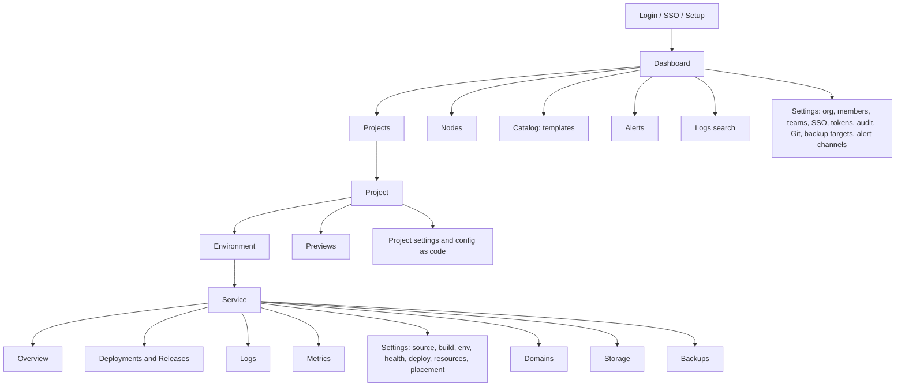
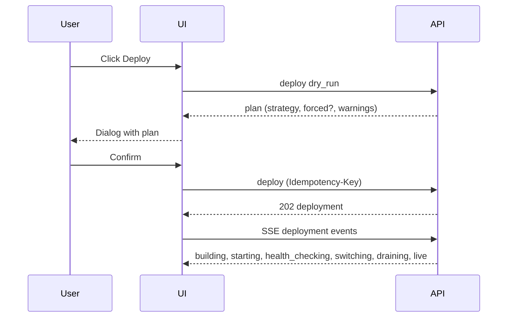

# 11 – Web UI

React 18 + TypeScript + Vite SPA, TanStack Router and Query, Tailwind CSS, shadcn/ui. It is built to static files, embedded in `polipan-server` and served at `/`. It uses only the public API ([REQ-CORE-009](02-architecture.md#requirements)) through a TypeScript client generated from [openapi.yaml](openapi.yaml). Live data comes from SSE.

The full UI/UX design specification is in [ui/](ui/README.md): [principles](ui/principles.md), [design system and tokens](ui/design-system.md), [responsive rules](ui/responsive.md), [navigation](ui/navigation.md), [screens](ui/screens.md) with the [API map](ui/api-map.md), the [Easypanel parity matrix](ui/parity.md), [components](ui/components.md), [flows](ui/flows.md), [accessibility, i18n, performance and tests](ui/quality.md) and [wireframes](ui/wireframes.md) and the [terminal style](ui/terminal-style.md) (look and feel, `REQ-UI-034`..`REQ-UI-043`). This file keeps the first screen list and the base rules. Requirements `REQ-UI-014`..`REQ-UI-043` are defined in the `ui/` files and are listed in [traceability](traceability.md). Where the two disagree, the more detailed `ui/` file is used for layout and states, and this file for the base rules in section 4.

## 1. Navigation map

## 2. Screens

| Id | Screen | Content | Main API |
|---|---|---|---|
| UI-01 | Login | Email/password, 2FA step, SSO buttons, reset link | `login`, `listLoginProviders` |
| UI-02 | First setup | Create first owner (from one-time URL) | `setupFirstUser` |
| UI-03 | Dashboard | Counts, firing alerts, recent deployments, node health, services not healthy, "no backup" and "restore not verified" warnings | `listProjects`, `listAlertInstances`, `listNodes`, `streamEvents` |
| UI-04 | Project page | Environments as tabs with kind badges (production is red-bordered when protected). Service cards with state. Add service. | `getProject`, `listEnvironments`, `listServices` |
| UI-05 | Add service | Choose: App from Git, App from image, Database, Template, Compose import | `createService`, `instantiateTemplate`, `importCompose` |
| UI-06 | Service overview | State, live release, replicas with node and health, URL list, last deploy, quick actions (Deploy, Restart, Stop, Rollback), pending changes banner | `getService` |
| UI-07 | Deploy dialog | Commit, strategy with plan (why forced), expected downtime, warnings, canary options, confirm | `deployService` with `dry_run` |
| UI-08 | Deployment page | Live step timeline (states of [08](08-deploy-engine.md)), health results per replica, canary step bar with gate values and buttons Promote/Pause/Abort, build log, cancel | `getDeployment`, `streamDeploymentEvents` |
| UI-09 | Releases tab | List with number, commit, author, time, status, fast-rollback badge. Diff of two. "Roll back" with a confirm that lists what is restored and not. Note edit. | `listReleases`, `rollbackService`, `diffReleases` |
| UI-10 | Promote dialog | Source release, target environment, diff table, missing variables, plan hash confirm | `promoteRelease` with `dry_run` |
| UI-11 | Variables and secrets | Table by scope with inheritance view, flags, bulk import, secret rows show only name/version/updated, "set new value" | variable and secret operations |
| UI-12 | Domains | Domain list with TLS state, DNS records to create, add/move/remove | domain operations |
| UI-13 | Storage | Volumes with usage, access mode, node. Orphan volumes list. | volume operations |
| UI-14 | Health check settings | Type, path, thresholds with defaults shown, "Test now" | `testHealthCheck` |
| UI-15 | Logs | Live tail with pause, filters, replica selector, and Search mode (text, fields, time range, highlight, context) | `streamServiceLogs`, `searchLogs` |
| UI-16 | Metrics | Charts: CPU, memory, network, disk, requests, 5xx, p50/p95/p99. Range selector up to retention. Release markers on the time axis. | `getServiceMetrics` |
| UI-17 | Backups | Policies, runs, targets, restore wizard (in place or new service), restore check history, "Restore verified N days ago" badge | backup operations |
| UI-18 | Previews | List with PR link, URL, state, expiry, delete. Settings (enable, base env, limits, forks, selector). | `listPreviews`, `updateProject` |
| UI-19 | Nodes | Table with state, labels, CPU/RAM/disk bars, workloads. Add node dialog (shows install command). Node page with actions (cordon, drain, maintenance, delete), charts, self-check. | node operations |
| UI-20 | Move service | Dialog from service page: target node, data copy mode, downtime warning | `moveService` |
| UI-21 | Catalog | Templates grid, search, instantiate form from `inputs` | template operations |
| UI-22 | Alerts | Firing/resolved list, rules, channels with test button, mute | alert operations |
| UI-23 | Settings → Members and Teams | Invite, role change, project overrides, teams | member and team operations |
| UI-24 | Settings → SSO | Providers, test login, group mappings, "SSO required" switch | SSO operations |
| UI-25 | Settings → Tokens | Own tokens with scopes, create (shows token once), revoke | token operations |
| UI-26 | Settings → Audit | Filterable table, diff viewer, verify chain button, export | audit operations |
| UI-27 | Settings → Git connections | Add GitHub App/GitLab/Gitea, repos list, webhook URL | git operations |
| UI-28 | Settings → Organization | Name, domains (default suffix, preview domain), retention, ACME DNS provider, 2FA policy | `updateOrg` |
| UI-29 | Project → Config as code | Source repo/path, sync state, last plan, "Plan now", export button, drift list | config operations |
| UI-30 | Terminal | Exec into a container (xterm), audited | `execService` |

Screens `UI-31`..`UI-49` (onboarding and first server join, service wizard, environments, deployments list, release diff, preview detail, logs search, backup targets, restore wizard, node detail, failover history, palette, profile, teams, members, notifications, error pages, alert channels and rules, secret versions) are in [ui/screens](ui/screens.md#4-screens-ui-31-to-ui-49). `UI-05` is the chooser that starts the wizard `UI-32`. For every screen the data, actions, states, roles and layout per breakpoint are in [ui/screens](ui/screens.md#3-screens-ui-01-to-ui-30).

## 3. Key flows

### 3.1 Deploy with blue-green

### 3.2 Rollback

User opens Releases → picks release → "Roll back" → dialog (what is restored, what is not, data is not rolled back, fast rollback available or not) → confirm → deployment page.

### 3.3 Promote

User opens the staging service → Promote → picks `production` → UI calls promote with `dry_run` → shows diff, missing variables, strategy → user confirms (admin needed on protected) → deployment page of the production service.

### 3.4 Add a node

Nodes → Add node → name and labels → UI shows the one-line command with a copy button and the 1 h expiry → the node row appears as `pending` and turns `ready` live.

## 4. Rules and requirements

- **REQ-UI-001** (MUST) Every screen in section 2 exists, and every action in the feature files has a UI path. Screens are reachable by a stable URL (deep links).
- **REQ-UI-002** (MUST) The UI shows live state through SSE with automatic reconnect and no manual refresh for deployments, node states and alerts.
- **REQ-UI-003** (MUST) Destructive actions (delete service/project/volume/node, restore in place, force options) need a typed confirmation of the name. Rollback and deploy on a protected environment show a banner "Production".
- **REQ-UI-004** (MUST) The UI hides or disables actions the user's role cannot do, using the permissions from `getMe`. The server still enforces them.
- **REQ-UI-005** (MUST) Secrets are never displayed after save. Secret inputs are write-only fields.
- **REQ-UI-006** (MUST) Fields managed by git are read-only with a "managed by polipan.yaml" label and a link to the file.
- **REQ-UI-007** (MUST) The deploy dialog always shows the strategy that will really run, why it was forced if it was, and whether downtime is expected ([REQ-DEPLOY-007](04-features/F01-zero-downtime-deploy.md#rules)).
- **REQ-UI-008** (SHOULD) Keyboard accessible, WCAG 2.1 AA contrast, labels for all inputs, dark and light theme.
- **REQ-UI-009** (SHOULD) UI language is English only in v1. All strings go through an i18n layer so later languages can be added ([Q-09](15-open-questions.md)).
- **REQ-UI-010** (MUST) Empty states explain the next step (for example "Add your first service").
- **REQ-UI-011** (MUST) The SPA works at widths from 360 px (read, deploy, rollback, logs) to desktop. The terminal and diff screens may be desktop only. Breakpoints, layouts and the list of what a phone may not do are in [ui/responsive](ui/responsive.md); the phone keeps deploy, rollback, canary controls, restart, logs and alerts.
- **REQ-UI-012** (MUST) The UI makes no requests to third-party hosts (no external fonts, analytics, CDNs). CSP forbids it ([REQ-OSS-005](04-features/F11-open-source.md#rules)).
- **REQ-UI-013** (SHOULD) Service state colors are consistent: green running, yellow deploying/degraded, red failed, grey stopped. Never color alone (also text/icon). Each state has its own icon shape (running filled circle, deploying and degraded triangle, failed cross, stopped square, fast rollback bolt), and an environment of kind production always shows a "Production" chip and a red top border, while a protected environment of any kind shows a lock, a "Protected" chip and a red top border ([ui/design-system](ui/design-system.md#4-status-vocabulary)).
