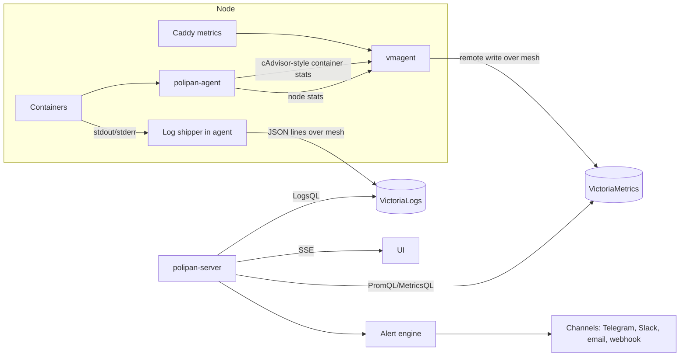

# 12 – Observability

How metrics, logs, events and alerts flow. User features: [C07](04-features/C07-logs-metrics-basic.md) and [F09](04-features/F09-alerts-metrics-logs.md). Defaults: [glossary](01-glossary.md#defaults).

## 1. Pipeline

## 2. Metrics

| Source | Metrics (names are fixed, prefix `polipan_`) | Labels |
|---|---|---|
| Container | `polipan_container_cpu_usage_millis`, `polipan_container_memory_bytes`, `polipan_container_memory_limit_bytes`, `polipan_container_net_rx_bytes`, `polipan_container_net_tx_bytes`, `polipan_container_blkio_bytes`, `polipan_container_restarts_total` | `org`, `project`, `environment`, `service`, `release`, `node`, `replica` |
| Node | `polipan_node_cpu_usage_millis`, `polipan_node_memory_bytes`, `polipan_node_disk_used_bytes`, `polipan_node_disk_total_bytes`, `polipan_node_load1`, `polipan_node_containers` | `node` |
| Volume | `polipan_volume_used_bytes`, `polipan_volume_inodes_used` | `service`, `volume`, `node` |
| Ingress (Caddy) | `polipan_http_requests_total`, `polipan_http_request_duration_seconds` (histogram) | `service`, `release`, `domain`, `status_class`, `node` |
| Health | `polipan_health_check_up`, `polipan_health_check_duration_seconds` | `service`, `release`, `replica` |
| Agent | `polipan_agent_heartbeat_age_seconds`, `polipan_agent_desired_state_version` | `node` |
| Platform | `polipan_deployments_total{state}`, `polipan_deploy_duration_seconds`, `polipan_backup_last_success_timestamp`, `polipan_restore_check_last_result` | `service`, `policy` |

- Scrape interval: 15 s. Retention: `metrics_retention`. Raw data 7 days, then downsampled to 5 min.
- The `release` label on ingress metrics is what lets canary compare green and blue ([08](08-deploy-engine.md#6-canary)). Caddy gets the `release` label per upstream from the route spec.
- Series cardinality guard: the agent drops labels beyond the fixed list. Request path is never a label.

## 3. Logs

- The agent reads Docker `json-file` logs (stdout and stderr) per container with a follow cursor saved on disk, so a restart does not lose or duplicate lines.
- Each line is sent as one JSON object to VictoriaLogs with the fields of [REQ-OBS-001](04-features/C07-logs-metrics-basic.md#rules) plus `_msg` (the line) and `_time`.
- Stream fields (index): `org`, `project`, `environment`, `service`, `node`. Other fields are normal fields.
- Retention: `logs_retention`. Per-project override is applied by a periodic delete job.
- Masking: the agent masks secret values of the service before sending ([10](10-security.md#4-secrets)).
- Platform logs (server and agent own logs) go to the same store with `service = polipan-server` or `polipan-agent` and are visible to `admin`+ only.
- Fallback: when VictoriaLogs is down, the agent buffers up to 100 MiB per node on disk (oldest dropped first), and live tail uses `docker logs`.
- Search API maps filters to LogsQL. The query text is escaped. Users cannot send raw LogsQL in v1 (only text, phrase, regex and fields).

## 4. Events

- The server writes a row in `events` in the same transaction as every state change of deployments, nodes, services, backups and alerts. SSE subscribers read from it (with `Last-Event-ID`).
- Events older than 7 days are deleted.

## 5. Alert engine

- Evaluation loop every 30 s for metric rules. Platform-event rules fire from the event insert (no loop).
- State is in `alert_instances` ([03](03-data-model.md)). On start, the engine loads firing instances so it never double-sends.
- Notification worker uses the queue (`jobs`), 3 attempts with back-off 10 s, 60 s, 300 s.
- Child suppression: while a `node_down` alert for node N is firing, service-level alerts for placements on N are suppressed.
- Message templates are fixed per rule type and channel kind. They contain severity, rule name, scope, since, link, and details.

## 6. Self-monitoring

- `GET /healthz` reports database, queue lag and VictoriaMetrics/VictoriaLogs reachability.
- The server exposes its own metrics at `/metrics` (Prometheus format, requires a token with `admin` scope or listens on a separate local port set in config).
- Built-in rules watch: queue lag, DB connections, disk of the control-plane host, certificate expiry, audit chain.

## Requirements

- **REQ-OBS-100** (MUST) Metric names and labels follow section 2. Adding labels outside the list needs a spec change.
- **REQ-OBS-101** (MUST) Log content is stored as data and never interpreted. The UI escapes it. The log search escapes user input into the query.
- **REQ-OBS-102** (MUST) The log shipper does not lose or duplicate lines across agent restarts (cursor on disk).
- **REQ-OBS-103** (MUST) Ingress metrics carry `service` and `release` labels so per-release error rate and latency can be computed.
- **REQ-OBS-104** (MUST) The alert engine never sends duplicate notifications after a server restart.
- **REQ-OBS-105** (MUST) Child alerts of a down node are suppressed (section 5).
- **REQ-OBS-106** (SHOULD) The server exposes `/metrics` for external monitoring with authentication.
- **REQ-OBS-107** (MUST) Events are written in the same transaction as the state change they describe.
