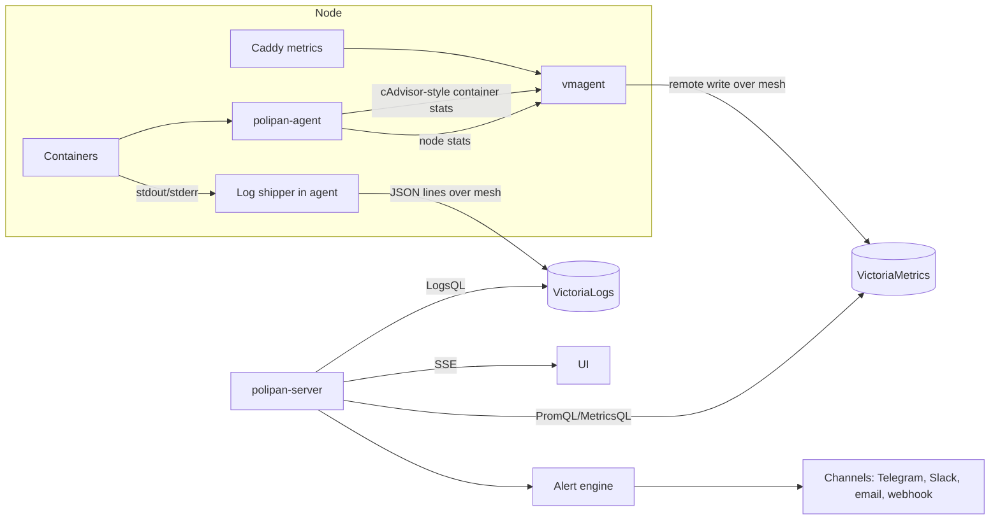

# 12 – Observability

How metrics, logs, events and alerts flow. User features: [C07](04-features/C07-logs-metrics-basic.md) and [F09](04-features/F09-alerts-metrics-logs.md). Defaults: [glossary](01-glossary.md#defaults).

## 1. Pipeline

## 2. Metrics

| Source | Metrics (names are fixed, prefix `polipan_`) | Labels |
|---|---|---|
| Container | `polipan_container_cpu_usage_millis`, `polipan_container_memory_bytes`, `polipan_container_memory_limit_bytes`, `polipan_container_net_rx_bytes`, `polipan_container_net_tx_bytes`, `polipan_container_blkio_bytes`, `polipan_container_restarts_total` | `org`, `project`, `environment`, `service`, `release`, `node`, `replica` |
| Node | `polipan_node_cpu_usage_millis`, `polipan_node_memory_bytes`, `polipan_node_disk_used_bytes`, `polipan_node_disk_total_bytes`, `polipan_node_load1`, `polipan_node_containers` | `node` |
| File system | `polipan_node_fs_used_bytes`, `polipan_node_fs_avail_bytes`, `polipan_node_fs_size_bytes` (section 7.1) | `node`, `mountpoint`, `roles` |
| Volume | `polipan_volume_used_bytes`, `polipan_volume_inodes_used` | `service`, `volume`, `node` |
| Ingress (Caddy) | `polipan_http_requests_total`, `polipan_http_request_duration_seconds` (histogram) | `service`, `release`, `domain`, `status_class`, `node` |
| Health | `polipan_health_check_up`, `polipan_health_check_duration_seconds` | `service`, `release`, `replica` |
| Agent | `polipan_agent_heartbeat_age_seconds`, `polipan_agent_desired_state_version` | `node` |
| Platform | `polipan_deployments_total{state}`, `polipan_deploy_duration_seconds`, `polipan_backup_last_success_timestamp`, `polipan_restore_check_last_result` | `service`, `policy` |

- Scrape interval: 15 s. Retention: `metrics_retention`. Raw samples are kept for the whole retention. There is no downsampling (it is an Enterprise-only feature of VictoriaMetrics). Long ranges use a larger query `step`.
- The `release` label on ingress metrics is what lets canary compare green and blue ([08](08-deploy-engine.md#6-canary)). Caddy gets the `release` label per upstream from the route spec.
- Series cardinality guard: the agent drops labels beyond the fixed list. Request path is never a label.

## 3. Logs

- The agent reads Docker `json-file` logs (stdout and stderr) per container with a follow cursor saved on disk, so a restart does not lose or duplicate lines.
- Each line is sent as one JSON object to VictoriaLogs with the fields of [REQ-OBS-001](04-features/C07-logs-metrics-basic.md#rules) plus `_msg` (the line) and `_time`.
- Stream fields (index): `org`, `project`, `environment`, `service`, `node`. Other fields are normal fields.
- Retention: `logs_retention`. Per-project override is applied by a periodic delete job.
- Masking: the agent masks secret values of the service before sending ([10](10-security.md#4-secrets)).
- Platform logs (server and agent own logs) go to the same store with `service = polipan-server` or `polipan-agent` and are visible to `admin`+ only.
- Fallback: when VictoriaLogs is down, the agent buffers up to 100 MiB per node on disk (oldest dropped first), and live tail uses `docker logs`.
- Search API maps filters to LogsQL. The query text is escaped. Users cannot send raw LogsQL in v1 (only text, phrase, regex and fields).

## 4. Events

- The server writes a row in `events` in the same transaction as every state change of deployments, nodes, services, backups and alerts. SSE subscribers read from it (with `Last-Event-ID`).
- Events older than 7 days are deleted.

## 5. Alert engine

- Evaluation loop every 30 s for metric rules. Platform-event rules fire from the event insert (no loop).
- State is in `alert_instances` ([03](03-data-model.md)). On start, the engine loads firing instances so it never double-sends.
- Notification worker uses the queue (`jobs`), 3 attempts with back-off 10 s, 60 s, 300 s.
- Child suppression: while a `node_down` alert for node N is firing, service-level alerts for placements on N are suppressed.
- Message templates are fixed per rule type and channel kind. They contain severity, rule name, scope, since, link, and details.

## 6. Self-monitoring

- `GET /healthz` reports database, queue lag and VictoriaMetrics/VictoriaLogs reachability.
- The server exposes its own metrics at `/metrics` (Prometheus format, requires a token with `admin` scope or listens on a separate local port set in config).
- Built-in rules watch: queue lag, DB connections, disk of the control-plane host, certificate expiry, audit chain.

## Requirements

- **REQ-OBS-100** (MUST) Metric names and labels follow section 2. Adding labels outside the list needs a spec change.
- **REQ-OBS-101** (MUST) Log content is stored as data and never interpreted. The UI escapes it. The log search escapes user input into the query.
- **REQ-OBS-102** (MUST) The log shipper does not lose or duplicate lines across agent restarts (cursor on disk).
- **REQ-OBS-103** (MUST) Ingress metrics carry `service` and `release` labels so per-release error rate and latency can be computed.
- **REQ-OBS-104** (MUST) The alert engine never sends duplicate notifications after a server restart.
- **REQ-OBS-105** (MUST) Child alerts of a down node are suppressed (section 5).
- **REQ-OBS-106** (SHOULD) The server exposes `/metrics` for external monitoring with authentication.
- **REQ-OBS-107** (MUST) Events are written in the same transaction as the state change they describe.
- **REQ-OBS-108** (MUST) Disk alerts are per file system: the root, the Docker data-root and the BuildKit state. Built-in levels are 70 % and 85 % (warning) and 95 % (critical). The message names the file system, its roles, and the used, free and total bytes (section 7.1).
- **REQ-OBS-109** (MUST) Automatic cleanup removes only dangling images that no container uses and unused BuildKit cache. It never removes a volume, an image with a tag or digest name (so never a release image), or an image that a container uses (section 7.1).
- **REQ-OBS-110** (MUST) Every container the agent creates has a rotated `json-file` log (`max-size` 10m, `max-file` 3).

## 7. Wire details (M8)

How the pipeline of sections 1 to 3 is wired. These details are fixed so that the agent and the server fit together.

- **Label values are ids.** `org`, `project`, `environment`, `service`, `release`, `node` hold ids (`org_`, `prj_`, `env_`, `svc_`, `rel_`, `nod_`), so a rename does not break history. `replica` is the replica index. The server puts these labels on every workload in the desired state (`polipan.org`, `polipan.project`, `polipan.environment`, `polipan.service`, `polipan.release`, `polipan.replica`).
- **Agent metrics.** The agent serves Prometheus text on `127.0.0.1:9445/metrics` (`POLIPAN_AGENT_METRICS_ADDR`). It holds all metrics of section 2 except the platform ones. Ingress metrics come from the Caddy access log: the agent maps the upstream of each request to its route (`service`) and release, and counts them. Caddy itself has no `release` label.
- **vmagent.** The agent runs the container `polipan-vmagent` (host network, image from `TelemetrySpec`). It scrapes the agent every `scrape_interval_seconds` and writes to `metrics_write_url` with the client certificate of the agent. When the server is not reachable, vmagent buffers on disk (up to `buffer_mib`).
- **Ingest listener.** The server has an mTLS HTTPS listener (`ingest_listen`, default `:9444`, same CA as the gateway). The node is the certificate CN. `POST /ingest/metrics` takes Prometheus remote write. The server checks each series against the placements of the node, sets `org`, `project`, `environment` and `node` from its own data, drops series of services that are not on the node, and writes to VictoriaMetrics. `POST /ingest/logs` takes JSON lines with `_time`, `_msg`, `service`, `release`, `container`, `stream`, `level`, `replica`. The server sets the stream fields the same way and writes to VictoriaLogs.
- **Log batches.** A batch has the header `X-Polipan-Batch: <epoch>.<n>`. `epoch` is random per agent data directory, `n` grows by one per batch. The agent keeps a batch on disk until the server answers 2xx. The server remembers the last `n` per node and epoch and answers 2xx without writing for a batch it has seen. So a restart of the agent, or of the server, does not lose or repeat lines.
- **Platform metrics** (`polipan_deployments_total`, `polipan_backup_last_success_timestamp`, `polipan_restore_check_last_result`, `polipan_agent_heartbeat_age_seconds`, `polipan_agent_desired_state_version`) are written by the server itself every 15 s.
- **Access to VictoriaMetrics and VictoriaLogs.** They have no host port. They run on the internal control-plane network and only the server talks to them. The server filters every query by the org of the caller.

### 7.1 Disk levels and cleanup

- **File systems.** The agent measures three paths: `/` (role `root`), the Docker data-root from `GET /info` (role `docker`) and the host path of the state of the `buildkitd` container of the panel (role `buildkit`, compose service `buildkitd`; `POLIPAN_AGENT_BUILDKIT_ROOT` overrides it). Paths on one device give one series. `mountpoint` is its mount point and `roles` the sorted roles, for example `buildkit,docker,root`. The used share is `used / (used + avail)`, like `df`: the root reserve is not free space for the services. `polipan_node_disk_*` (the root only) stays for the charts and older agents.
- **Rules.** `disk_high` checks every file system of the node. The built-in rules are `Disk 70%` (warning, 5 min), `Disk 85%` (warning, 5 min) and `Disk 95%` (critical, 2 min). Thresholds and times are the rule params and can be changed per org. The fingerprint is the node (root) or `node:mountpoint` (other file systems). The message is, for example: `Disk / (buildkit, docker, root) of node local is at 86.4% (limit 85%): 14.1 GiB used, 2.2 GiB free of 16.9 GiB`. An org with the old built-in `Disk high` rule gets the three levels with its channels once; the old rule is deleted when it still has its defaults (90 %, 5 min), or else it stays as a normal rule.
- **Image cleanup (agent).** Every hour, and every 15 minutes while a file system is at 85 % or more, the agent removes the images that have no tag and no digest name, that no container (in any state) uses, and that are older than one hour. It removes them by id without force, so Docker refuses an image in use. It never removes volumes or named images: release images are pulled by digest and have a name, so they are kept; old releases go only by the retention of [08](08-deploy-engine.md). Settings: `POLIPAN_AGENT_CLEANUP` (default on), `POLIPAN_AGENT_CLEANUP_INTERVAL` (default 1h), `POLIPAN_AGENT_CLEANUP_HIGH_PERCENT` (default 85).
- **Build cache cleanup (server).** Every hour, and every 15 minutes while the BuildKit file system is at 85 % or more, the server runs `buildctl prune --keep-duration <build_cache_keep>` and then `buildctl prune --keep-storage <build_cache_max_mb>`. BuildKit never removes cache that a running build uses, and `--all` is not given. Settings: `build_cache_keep` (`POLIPAN_BUILD_CACHE_KEEP`, default 168h), `build_cache_max_mb` (`POLIPAN_BUILD_CACHE_MAX_MB`, default 5120).
- **Container logs.** The agent creates every container with the log driver `json-file`, `max-size` 10m and `max-file` 3. A running container keeps its old log settings until it is created again (next deploy).
