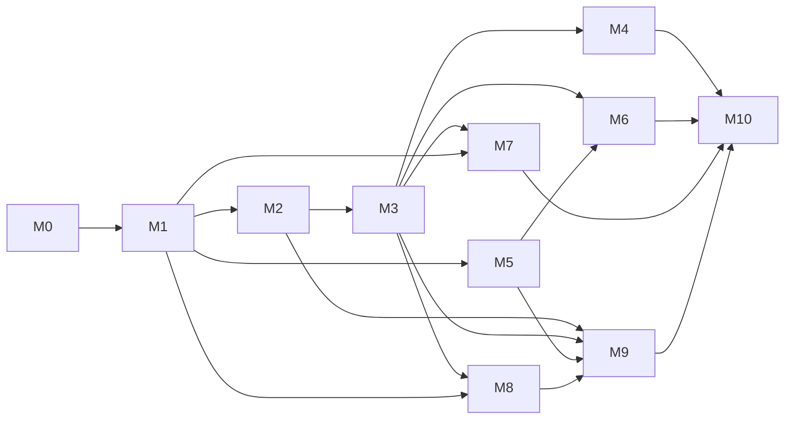

# 14 – Roadmap and Milestones

Ordered build milestones `M0`–`M10`. Each has a goal, the requirements it completes (**Covers**), dependencies, work packages for parallel agents, and **done criteria** that can be checked by tests. A requirement belongs to exactly one milestone: the one where it is **complete**. A milestone may start parts of later requirements (for example UI screens), but those are only checked in the milestone that lists them. [traceability](traceability.md) is built from the `Covers` lines.

## 1. Dependency graph

## 2. Parallel plan

| Wave | Milestones that can run at the same time | Notes |
|---|---|---|
| 1 | M0 | One agent sets up the repo, CI, codegen. Others wait for the skeleton. |
| 2 | M1 | Agent track and server track in parallel after the proto is generated. |
| 3 | M2 ∥ M5 | M5 only needs the M1 server skeleton and DB. Permission checks for later endpoints are added as endpoints appear. |
| 4 | M3 | Needs M2 (images, secrets, volumes). |
| 5 | M4 ∥ M6 ∥ M7 ∥ M8 | M6 needs M3 and M5. M8 observability work package can start after M1 (agent), canary work package needs M3. |
| 6 | M9 | Needs M8 metrics (canary and previews use the pipeline) and M5 (protected envs). |
| 7 | M10 | Integration, SSO, hardening, release. |

Tracks inside a milestone: **S** server/API, **A** agent, **W** web UI, **C** CLI/Terraform, **T** tests/CI/docs. A work package (WP) is sized for one agent working about 1–3 days of agent time. Packages in the same milestone that do not list a dependency can be built in parallel.

## 3. Milestones

### M0 – Repository, CI and skeletons

- **Goal:** an empty but complete engineering base.
- **Depends on:** none.
- **Covers:** REQ-CORE-001, REQ-CORE-002, REQ-CORE-004, REQ-CORE-005, REQ-CORE-009..012, REQ-CORE-020, REQ-CORE-030..035, REQ-API-001, REQ-API-002, REQ-API-004, REQ-API-007, REQ-API-008, REQ-API-100, REQ-API-101, REQ-API-104, REQ-API-105, REQ-OSS-001..003, REQ-OSS-008, REQ-OSS-009, REQ-UI-014..018, REQ-UI-028.
- **Work packages:**
  - WP0.1 (T) Monorepo layout of [02](02-architecture.md#3-repository-layout-monorepo-to-be-created-by-m0), `LICENSE`, governance files, CI pipeline with all gates of [13](13-testing-and-quality.md#3-ci-gates-all-must-pass-to-merge) that can run on an empty code base.
  - WP0.2 (S) `polipan-server` skeleton: config loading, PostgreSQL connection, migration runner, baseline migration for the identity tables, job queue, structured logging, request ids, error model, rate limiter, `/healthz`, `/version`.
  - WP0.3 (S) OpenAPI codegen: server stubs, Go client, TypeScript client. Route registration checked against `x-permission` ([REQ-API-101](05-api.md#requirements)).
  - WP0.4 (A) `polipan-agent` skeleton and generated gRPC code from `agent.proto`. `buf` lint and breaking checks.
  - WP0.5 (W) Web skeleton (Vite, router, API client, layout, theme) embedded in the server binary. It includes the [UI foundation](ui/README.md): token file to CSS variables, light, dark and system theme without flash, app shell for four breakpoints (sidebar, rail, bottom bar), i18n layer with the string lint, the base components of [ui/components](ui/components.md) (button, inputs, badge, table and card list, dialog and sheet, toast, banner, skeleton), a mock API generated from `openapi.yaml`, and the Playwright harness for visual tests in both themes at 4 widths. All later UI work packages depend only on WP0.5.
- **Done criteria:**
  1. `server`, `agent`, `cli`, `web` build in CI and produce binaries and images.
  2. `/healthz` returns ok with the database up.
  3. CI gates 1, 3, 4, 5, 6, 7, 8 run and pass (the ones that apply with no features).
  4. A test fails when an operation has no `x-permission`, and when a route is not in the OpenAPI file.
  5. The first migration applies on an empty database and the schema matches the DDL in [03](03-data-model.md) for the included tables.
  6. The web skeleton passes the contrast test of REQ-UI-014, the theme tests of REQ-UI-015 (system follow, no flash), the 360 px no-scroll and touch-target tests of REQ-UI-016 and REQ-UI-017, and the table-to-card test of REQ-UI-018.

### M1 – Single node: agent, Docker, Caddy, app from image with domain and HTTPS

- **Goal:** a working panel on one server. An image service runs behind HTTPS (strategy `recreate`).
- **Depends on:** M0.
- **Covers:** REQ-CORE-006..008, REQ-AGENT-001..005, REQ-AGENT-007, REQ-AGENT-009, REQ-AGENT-010, REQ-NODE-002, REQ-NODE-005, REQ-APP-003, REQ-APP-006, REQ-APP-009, REQ-APP-012, REQ-DOM-001..005, REQ-DOM-008, REQ-DOM-010, REQ-DOM-011, REQ-AUTH-001, REQ-AUTH-003, REQ-AUTH-005, REQ-AUTH-006, REQ-AUTH-100.
- **Work packages:**
  - WP1.1 (S) Server CA, join token, `AgentJoin` and `AgentGateway` (mTLS), desired state versioning, node states from heartbeats.
  - WP1.2 (A) Agent: join, stream, persist desired state, Docker reconcile (pull, create, start, stop, remove, restart), embedded DNS, nftables.
  - WP1.3 (A) Caddy management: container, admin socket, full JSON build from `IngressSpec`, one `POST /load`, ACME, 503 page.
  - WP1.4 (S) Hierarchy API: projects, environments, services (image source), domains. Recreate deployment with simple health (TCP). Docker `logs` tail as the log path until M8.
  - WP1.5 (S) Auth: first-user setup, local login, session cookie, CSRF. Org row, single org.
  - WP1.6 (W) Screens UI-01, UI-02, UI-03 (basic), UI-04, UI-12, UI-33, UI-43 (profile and theme), UI-47, project and service pages (basic), domain page.
  - WP1.7 (S) Installer script and compose file for the control plane (PostgreSQL, server), install of the local agent.
- **Done criteria:**
  1. On a clean Ubuntu 24.04 VM the install command works and the first user can log in (AC-AUTH-03).
  2. A user creates an image service with a domain, and `https://host` serves it with a valid certificate (AC-DOM-01, AC-DOM-02, AC-DOM-03, AC-DOM-04, AC-DOM-05).
  3. Stop and start work (AC-APP-05).
  4. Server stopped for 5 min: the app still serves and the agent reconnects (T-E2E-13).
  5. A used or expired join token is refused (AC-NODE-02).
  6. T-E2E-01 passes.

### M2 – Git builds, registry, variables and secrets, volumes

- **Goal:** apps from Git with env vars, real secrets and persistent volumes.
- **Depends on:** M1.
- **Covers:** REQ-APP-001, REQ-APP-002, REQ-APP-004, REQ-APP-005, REQ-APP-007, REQ-APP-008, REQ-APP-010, REQ-APP-011, REQ-APP-013, REQ-ENV-001..008, REQ-ENV-010, REQ-VOL-001..006, REQ-VOL-009, REQ-DOM-006, REQ-DOM-009, REQ-SEC-001..010, REQ-SEC-101..105, REQ-SEC-107, REQ-SEC-108, REQ-AGENT-006, REQ-CORE-023, REQ-API-102, REQ-UI-005, REQ-UI-019, REQ-UI-020, REQ-UI-031.
- **Work packages:**
  - WP2.1 (S) Git connections (GitHub App, GitLab, Gitea, deploy key), inbound webhooks with signature and replay checks, auto-deploy trigger.
  - WP2.2 (S+A) Build pipeline: BuildKit, Railpack, Dockerfile, build logs, caches, built-in registry, digest capture, image pull auth per node.
  - WP2.3 (S) Secrets store: key hierarchy, versions, write-only API, injection, masking, rotation commands, `SecretProvider` interface.
  - WP2.4 (S) Variables: scopes, resolution, references, bulk import, build-time flags, pending changes.
  - WP2.5 (A) Volumes, bind mounts, file mounts, usage reporting.
  - WP2.6 (A) Exec terminal (WebSocket) and its audit hook, SSRF deny list.
  - WP2.7 (W) Screens UI-05, UI-11, UI-13, UI-30, UI-32 (git and image paths), UI-42 (command palette, context switcher), UI-49, wizard and unsaved-data warning.
- **Done criteria:**
  1. AC-APP-01 to AC-APP-04, AC-APP-06, AC-APP-07 pass.
  2. AC-ENV-01 to AC-ENV-05 pass.
  3. AC-SEC-01, AC-SEC-02, AC-SEC-03, AC-SEC-04, AC-SEC-05, AC-SEC-06 pass. Secret leak test (CI gate 9) passes.
  4. AC-VOL-01, AC-VOL-03 pass.
  5. T-E2E-02 passes except the rollback part (M3).

### M3 – Releases, blue-green, health checks, rollback

- **Goal:** gaps 1, 2 and 5: zero-downtime deploys with health-gated switch and one-click rollback.
- **Depends on:** M2.
- **Covers:** REQ-DEPLOY-001..005, REQ-DEPLOY-007..012, REQ-DEPLOY-100..104, REQ-DEPLOY-106..116, REQ-REL-001..012, REQ-HC-001..012, REQ-API-005, REQ-API-006, REQ-API-103, REQ-CORE-021, REQ-CORE-022, REQ-UI-002, REQ-UI-003, REQ-UI-007, REQ-UI-010, REQ-UI-013, REQ-UI-022, REQ-UI-023, REQ-UI-025, REQ-UI-032.
- **Work packages:**
  - WP3.1 (S) Release creation and immutability, `release_annotations`, retention and pruning, image GC.
  - WP3.2 (S) Deployment state machine, queue, supersede and cancel rules, crash recovery.
  - WP3.3 (S+A) Blue-green and recreate: scheduler (single node first), start green, `SwitchTraffic`, drain, retain stopped, post-switch check.
  - WP3.4 (A) Health check runner (`http`, `tcp`, `command`), reports, ingress upstream removal of unhealthy replicas, restart on unhealthy.
  - WP3.5 (S+A) Rollback (fast and normal), release diff, variable and secret version restore.
  - WP3.6 (S) `pre_deploy` and `post_deploy`, forced recreate rules and warnings, deploy plan (`dry_run`), idempotency keys, SSE streams with resume.
  - WP3.7 (W) Screens UI-06, UI-07, UI-08 (without canary bar), UI-09, UI-14, UI-31 (onboarding checklist, local steps), UI-34, UI-35, UI-46 (deployments part), empty, loading, error and disconnected states on every screen built so far, and the CI check that every `operationId` in [ui/screens](ui/screens.md) exists.
- **Done criteria:**
  1. AC-DEPLOY-01, 02, 04, 05, 06, 07, 08, 09 pass.
  2. AC-REL-01 to AC-REL-08 pass.
  3. AC-HC-01 to AC-HC-06 pass.
  4. AC-VOL-02 passes (forced recreate).
  5. T-E2E-02 and T-E2E-03 pass. Fast rollback is under `fast_rollback_target` on the CI VM.
  6. Chaos: kill server in `switching`, restart: the deployment ends in a terminal state (REQ-DEPLOY-107).

### M4 – Databases, templates, backups with restore checks

- **Goal:** managed databases, template catalog and gap 10.
- **Depends on:** M3.
- **Covers:** REQ-DB-001..009, REQ-TPL-001..008, REQ-BKP-001..011, REQ-BKP-100..106.
- **Work packages:**
  - WP4.1 (S) Database services, credentials, references, exposure, version rules.
  - WP4.2 (S) Template engine, manifest validation, safety validator, Compose import, 12 built-in templates in `/templates`.
  - WP4.3 (S+A) Backup targets, policies, runs with restic, per-engine dump, retention, manual run, restore (in place and new service).
  - WP4.4 (S+A) Restore check runner, manifests, per-engine checks, temp container sandbox, results, control-plane DB policy.
  - WP4.5 (W) Screens UI-17, UI-21, UI-38, UI-39, UI-32 (template and database paths).
- **Done criteria:**
  1. AC-DB-01 to AC-DB-04, AC-TPL-01 to AC-TPL-04 pass.
  2. AC-BKP-01 to AC-BKP-10 pass (with MinIO and SFTP targets). AC-C08-01 passes.
  3. T-E2E-09 passes except the alert delivery (M8).
  4. Restoring a plain restic repository with the `restic` binary works (AC-OSS-05).

### M5 – Users, roles, audit log, tokens

- **Goal:** gap 7 (teams, roles, audit, tokens). SSO comes in M10.
- **Depends on:** M1 (can run parallel with M2–M4).
- **Covers:** REQ-AUTH-002, REQ-AUTH-004, REQ-AUTH-007, REQ-AUTH-101, REQ-AUTH-102, REQ-RBAC-001..008, REQ-RBAC-100, REQ-RBAC-101, REQ-AUDIT-001..007, REQ-AUDIT-100, REQ-CORE-024, REQ-UI-004.
- **Work packages:**
  - WP5.1 (S) Authorization function (effective role, protected env, scopes), `x-permission` middleware, permission matrix test generator.
  - WP5.2 (S) Members, invitations, teams, project role overrides, last-owner rule.
  - WP5.3 (S) Audit log writer (hash chain, advisory lock), search, export, verify job, retention archive.
  - WP5.4 (S) 2FA, recovery codes, API tokens (hash, scopes, project limit), session management, password reset, `polipan-server admin` commands.
  - WP5.5 (W) Screens UI-23, UI-25, UI-26, UI-44, UI-45, UI-43 (sessions and 2FA) and permission-aware UI (hide or disable rule of [ui/screens](ui/screens.md#11-roles-and-permission-behavior)).
- **Done criteria:**
  1. AC-RBAC-01 to AC-RBAC-04, AC-AUTH-01, AC-AUTH-02, AC-AUDIT-01 to AC-AUDIT-03 pass.
  2. The generated matrix test passes for every operation and all four roles (T-E2E-10).
  3. T-E2E-14 passes.
  4. Every state-changing operation that exists at this time writes an audit event (a test enumerates operations from the OpenAPI file; later milestones keep it green).

### M6 – CLI, config as code, Terraform provider

- **Goal:** gap 8.
- **Depends on:** M3, M5.
- **Covers:** REQ-CLI-001..004, REQ-CLI-100..104, REQ-CAC-001..014, REQ-CAC-100..104, REQ-TF-001..005, REQ-ENV-009, REQ-UI-006.
- **Work packages:**
  - WP6.1 (C) CLI core: contexts, auth, output formats, exit codes, completion, commands for all areas that exist (M1–M5).
  - WP6.2 (S) Config engine: parse, validate (schema and semantic), merge, plan (diff), apply (ordered), `git_managed` fields, drift, export, prune rules.
  - WP6.3 (S) Git sync trigger (webhook on config path), commit status feedback.
  - WP6.4 (C) Terraform provider: resources and data sources, import, sensitive handling, docs generation, acceptance tests with a live server.
  - WP6.5 (W) Screen UI-29, read-only "managed by git" fields.
- **Done criteria:**
  1. AC-CAC-01 to AC-CAC-08, AC-API-01, AC-API-02, AC-CLI-01, AC-CLI-02, AC-TF-01, AC-TF-02 pass.
  2. Examples in [07](07-config-as-code.md#8-examples) validate and apply.
  3. T-E2E-12 passes.
  4. Every OpenAPI operation of M1–M5 is reachable from a CLI command (REQ-CLI-100).

### M7 – Many servers: join, mesh, placement, move, failover

- **Goal:** gap 6.
- **Depends on:** M3 (and M1).
- **Covers:** REQ-AGENT-008, REQ-NODE-001, REQ-NODE-003, REQ-NODE-004, REQ-NODE-006..012, REQ-NODE-100..103, REQ-VOL-007, REQ-SEC-100, REQ-SEC-106.
- **Work packages:**
  - WP7.1 (A) WireGuard mesh management, per-node subnets, routes, peer sync, nftables per environment.
  - WP7.2 (S) Remote node join flow, node actions (cordon, drain, maintenance, delete), node UI, install script for agents.
  - WP7.3 (S) Scheduler (filters, scoring, determinism), placement settings, multi-replica deploys, multi-node ingress and `ingress_node_ids`.
  - WP7.4 (S+A) Move service (stateless and with data copy), drain implemented as moves.
  - WP7.5 (S) Failover controller (policy, backup check, split-brain guard, "no reachable node" guard), audit and events.
  - WP7.6 (W) Screens UI-19, UI-20, UI-40, UI-41, UI-31 (add server step with live join).
- **Done criteria:**
  1. AC-NODE-01, 03, 04, 05, 06, 07, 08, 09, 10 pass.
  2. T-E2E-07 and T-E2E-08 pass on 3 VMs. The failover time target of AC-NODE-04 is met.
  3. A node receives only its own secrets (REQ-SEC-100 test: inspect desired state of node B for node A's workloads).
  4. Environment isolation test: a container in env X cannot connect to a container in env Y (REQ-SEC-106).

### M8 – Observability, alerts, canary

- **Goal:** gap 9 and the canary half of gap 1.
- **Depends on:** M3 and M1. The canary work package needs the metrics work package.
- **Covers:** REQ-OBS-001..007, REQ-OBS-010..015, REQ-OBS-100..107, REQ-ALERT-001..009, REQ-DEPLOY-006, REQ-DEPLOY-105, REQ-API-009, REQ-UI-026, REQ-UI-033.
- **Work packages:**
  - WP8.1 (A) vmagent, container/node/volume/health/ingress metrics, log shipper with cursor and buffer.
  - WP8.2 (S) VictoriaMetrics and VictoriaLogs in the installer, query layer, log search with LogsQL mapping, metrics API, retention settings, SSE log tail.
  - WP8.3 (S) Alert engine (rules, instances, dedup, repeat, resolve, mute, child suppression), channels (Telegram, Slack, email, webhook), default rules.
  - WP8.4 (S) Canary: steps, gates from metrics, promote/pause/abort, auto rollback, `canary_gate` events.
  - WP8.5 (W) Screens UI-15, UI-16, UI-22, UI-37, UI-46 (alerts part), UI-48, canary bar in UI-08, log viewer and chart components with their accessible alternatives, restore-verified badge on UI-03 and UI-17.
- **Done criteria:**
  1. AC-OBS-01 to AC-OBS-07, AC-ALERT-01 to AC-ALERT-05, AC-DEPLOY-03 pass.
  2. T-E2E-04, T-E2E-09 (alert part), T-E2E-15 pass.
  3. Server restart does not resend firing alerts (REQ-OBS-104).
  4. Log shipper restart test: no loss and no duplicates (REQ-OBS-102).

### M9 – Preview environments and promotion

- **Goal:** gaps 3 and 4.
- **Depends on:** M2, M3, M5, M8.
- **Covers:** REQ-PREV-001..014, REQ-PROMO-001..010, REQ-VOL-008, REQ-DOM-007.
- **Work packages:**
  - WP9.1 (S) PR event handling for GitHub, GitLab, Gitea. PR comments and commit statuses.
  - WP9.2 (S) Preview lifecycle: clone from base environment, naming, URLs, wildcard domain with DNS-01, limits, TTL, cleanup job, fork rules, secret isolation.
  - WP9.3 (S) Promotion: plan (dry run), env-specific field rules, missing variables, plan hash, batch ordering, protected env check.
  - WP9.4 (W) Screens UI-10 (final), UI-18, UI-36.
- **Done criteria:**
  1. AC-PREV-01 to AC-PREV-08 pass.
  2. AC-PROMO-01 to AC-PROMO-08 pass.
  3. AC-VOL-04 passes.
  4. T-E2E-05 and T-E2E-06 pass.

### M10 – SSO, hardening, 1.0 release

- **Goal:** finish gap 7 (SSO), gap 11 and quality gates. Ship 1.0.
- **Depends on:** M4, M6, M7, M9.
- **Covers:** REQ-SSO-001..006, REQ-SSO-100, REQ-OSS-004..007, REQ-API-003, REQ-CORE-003, REQ-UI-001, REQ-UI-008, REQ-UI-009, REQ-UI-011, REQ-UI-012, REQ-UI-021, REQ-UI-024, REQ-UI-027, REQ-UI-029, REQ-UI-030.
- **Work packages:**
  - WP10.1 (S) OIDC, Google, GitHub OAuth2, group mapping, `sso_required`, break-glass.
  - WP10.2 (T) Release pipeline: signed binaries and images (cosign), SBOM, checksums, install script verification, upgrade tests.
  - WP10.3 (T) Security pass: threat model table of [10](10-security.md#6-threat-model-stride) walked row by row with a test or a documented reason, fuzzing, dependency scan, performance and chaos suites.
  - WP10.4 (W) Screens UI-24, UI-27, UI-28, keyboard shortcuts and help overlay, accessibility and responsive pass, reduced-motion pass, performance budget gates, full UI test plan of [ui/quality](ui/quality.md#4-ui-test-plan) (visual regression in both themes at 4 widths), parity matrix CI check, CSP, no third-party requests.
  - WP10.5 (T) UI/API parity test, user docs site, upgrade guide, `SECURITY.md` process dry run.
- **Done criteria:**
  1. AC-SSO-01 to AC-SSO-03, AC-OSS-01 to AC-OSS-06, AC-API-03 pass. T-E2E-11 passes.
  2. All CI gates of [13](13-testing-and-quality.md#3-ci-gates-all-must-pass-to-merge) pass. All `T-E2E` scenarios pass nightly for 7 days in a row.
  3. Every AC of every feature file has a passing test whose name contains the AC id.
  4. Every row of the threat model has a linked test or a written accepted-risk note in the release notes.
  5. Performance suite targets in [13](13-testing-and-quality.md#2-test-levels) are met.
  6. Upgrade test from the previous pre-release passes.
  7. Version `1.0.0` is tagged and published with signatures and SBOM.
  8. UI: every screen of [ui/screens](ui/screens.md) is reachable by a stable URL; the parity matrix check ([REQ-UI-024](ui/parity.md#requirements)) passes; the axe tests have zero serious issues in light and dark at 360, 768, 1280 and 1920 px; the performance budgets of [ui/quality](ui/quality.md#3-performance-budget) are met; the keyboard-only deploy and rollback e2e tests pass.

## 4. After 1.0 (not part of v1)

| Item | Why later |
|---|---|
| External secret backends (Vault, OpenBao) behind `SecretProvider` | [Q-06](15-open-questions.md) |
| Required approvals for protected deploys | [Q-05](15-open-questions.md) |
| Automatic DNS (Cloudflare and others) | [Q-03](15-open-questions.md) |
| Control-plane high availability | [Q-04](15-open-questions.md) |
| Remote builder nodes and multi-arch builds | [Q-10](15-open-questions.md) |
| More UI languages | [Q-09](15-open-questions.md) |
| Header-based canary routing, shadow traffic | Needs Caddy matcher work and UI |
