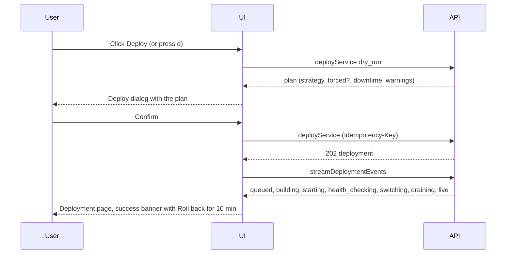
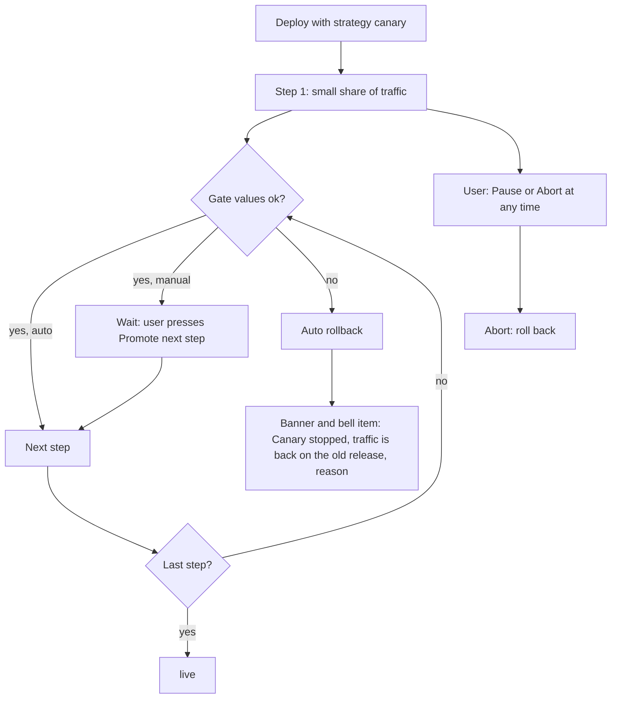
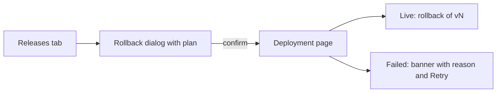
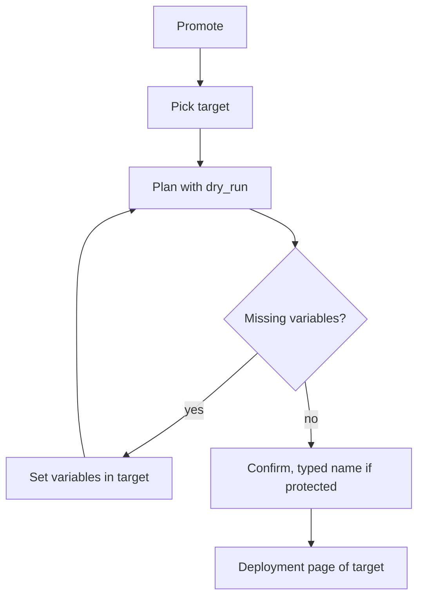
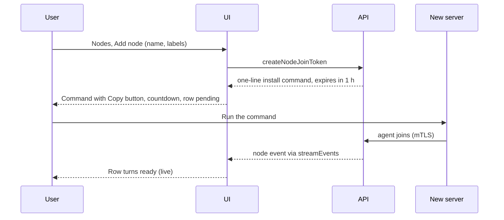
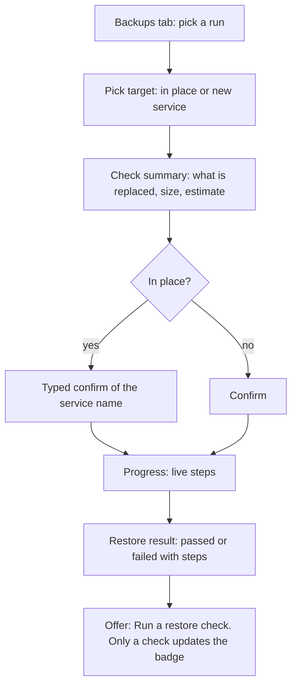
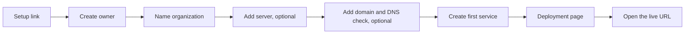

# Key Flows

The deploy engine states are in [08-deploy-engine](../08-deploy-engine.md#2-state-machine). The flows here show what the UI does at each step.

## 1. Deploy

Canary variant:

If the gate fails, the UI shows the banner on the deployment page (not only a toast) with the failed gate value and the threshold ([REQ-UI-032](components.md#requirements)).

## 2. Rollback

1. Releases tab (or the "Roll back" shortcut after a deploy) → pick a release → Roll back.
2. Dialog: what is restored (image, config, variable and secret versions) and what is not (data, volumes). Fast rollback badge ("about 5 seconds") or "needs a rebuild". The dialog is built from `getRelease` and `diffReleases` (live release against the target), because `rollbackService` has no `dry_run`.
3. Protected environment: banner "Production" and typed environment name.
4. Confirm → `rollbackService` → deployment page with the same timeline.
5. Result: the new live release shows "rollback of v41". The bell does not fire for the user's own action.

## 3. Promote staging to production

1. Staging service → Promote (or environment page → Promote all).
2. Pick target `production`. UI calls the promote operation with `dry_run`.
3. Diff table: changed fields, environment-specific values kept, missing variables in a red list (icon and word). Missing variables block Confirm until they are set in the target.
4. Strategy and downtime shown as in the deploy dialog.
5. Protected target: typed environment name, and admin needed (a developer sees the button disabled with the reason).
6. Confirm → deployment page of the production service. For a batch, a list of deployments in dependency order.

## 4. Add a server

If the countdown ends, the UI offers "Create a new command". After 5 min in `pending` the UI shows the checklist of causes (port, firewall, clock).

## 5. Restore

A failed restore shows the reason and keeps the original data untouched where the engine allows it (the text says which case applies).

## 6. First-run onboarding

Every step can be skipped. The dashboard shows the open steps until all are done or dismissed.
