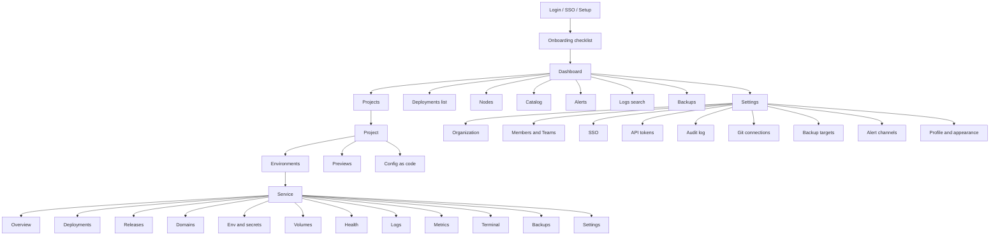

# Information Architecture and Navigation

## 1. Site map

Sidebar order (laptop): Dashboard · Projects · Deployments · Previews · Nodes · Catalog · Alerts · Logs · Backups · Settings. The phone bottom bar shows Home (Dashboard), Projects, Deploys (Deployments), Nodes and More (the rest).

## 2. URLs

Every screen has a stable URL (deep link, [REQ-UI-001](../11-ui.md#4-rules-and-requirements)). The router is TanStack Router. Search and filter state lives in the query string, so a link restores the view.

| Screen | Path |
|---|---|
| Dashboard | `/o/:org` |
| Project | `/o/:org/p/:project` |
| Environment | `/o/:org/p/:project/e/:env` |
| Service tab | `/o/:org/p/:project/e/:env/s/:service/:tab` (`tab` = overview, deployments, releases, domains, env, volumes, health, logs, metrics, terminal, backups, settings) |
| Deployment | `/o/:org/p/:project/e/:env/s/:service/deployments/:deployment` |
| Release diff | `.../releases/:release/diff/:other` |
| Add service wizard | `/o/:org/p/:project/e/:env/new` (`?source` = git, image, template or database) |
| Nodes, node | `/o/:org/nodes`, `/o/:org/nodes/:node` |
| Settings | `/o/:org/settings/:section` |
| Global lists | `/o/:org/deployments`, `/previews`, `/catalog`, `/alerts`, `/logs`, `/backups` |

Names in the URL are slugs. Unknown or forbidden ids show UI-47 (404 or 403) without leaking whether the object exists to a user without `*:read` on its parent.

## 3. Context switcher

- **REQ-UI-020** (MUST) A context switcher selects organization, project and environment. It is searchable, works with the keyboard, shows the environment kind badge, and remembers the last choice per user. A production or protected environment is marked on every page that belongs to it: a red top border and a "Production" chip. The mark cannot be hidden.

| Part | Behavior |
|---|---|
| Organization | v1 has one organization per install; the control shows its name and is a link to settings. The component supports a list for later. |
| Project | Searchable list, recent first, "Create project" at the end (`project:create`). |
| Environment | Tabs inside a project and a select in the switcher. Preview environments are grouped under "Previews". |
| Data | `listProjects`, `listEnvironments`. |
| Keyboard | `Ctrl/Cmd+K` then type, or `g p` for projects. Arrow keys, Enter, Esc. |
| Phone | Top-bar chip opens a full-screen sheet with search. |

## 4. Command palette and global search

- **REQ-UI-019** (MUST) `Ctrl+K` (Windows, Linux) and `Cmd+K` (macOS) open the command palette on every page after login. It is the global search. It lists only the commands the user's role allows, and it works with the keyboard alone.

| Part | Rule |
|---|---|
| Entities searched | Projects, environments, services, nodes, releases (by number or commit), templates, settings pages, screens. Client-side from cached lists plus `listProjects`, `listServices`, `listNodes`, `listTemplates` on demand. |
| Log search | The last row is always "Search logs for `<text>`", which opens UI-37 with the query. |
| Commands | Deploy…, Roll back…, Restart, Stop, Add node, Add service, Switch theme, Go to logs, Open metrics, Sign out. A command that needs a target asks for it in a second step (type to pick the service). |
| Role filter | A command is shown only if the role has its permission (`getMe`). On a protected environment a command the role cannot run there is shown disabled with the reason, as in [REQ-UI-004](../11-ui.md#4-rules-and-requirements). |
| Order | Recent items first, then best match. Prefix `>` shows commands only, `/` shows pages only. |
| Pattern | ARIA combobox with a listbox. Focus stays in the input. Results announce their count politely. Esc closes and returns focus. |
| Phone | Search icon in the top bar opens it full screen. No shortcut is needed. |
| Empty | "No result for `<text>`. Try a service name or a command." with the log search row. |

## 5. Keyboard shortcuts

- **REQ-UI-021** (SHOULD) The shortcuts below exist, and `?` opens a help overlay listing them. Shortcuts are off while an input has focus. No single key runs a destructive action. A user can turn single-key shortcuts off in UI-43.

| Keys | Action |
|---|---|
| `Ctrl/Cmd+K` | Command palette |
| `?` | Shortcut help (UI-42) |
| `/` | Focus the search or filter box of the page |
| `g d` / `g p` / `g n` / `g a` / `g l` | Go to Dashboard / Projects / Nodes / Alerts / Logs |
| `d` | Open the Deploy dialog (service page) |
| `r` | Open Releases (service page) |
| `l` | Open Logs (service page) |
| `[` and `]` | Previous and next tab |
| `t` | Cycle theme |
| `Esc` | Close dialog, sheet, palette or overlay |
| `Esc Esc` | Leave the terminal focus (terminal page) |

Deploy via `d` only opens the dialog, it does not run a deploy.

## 6. Notifications

The bell in the top bar lists firing alerts (`listAlertInstances`) and failed or finished deployments from the live event stream (`streamEvents`). The count is a number plus the word in the accessible name ("3 notifications"). Toasts report the user's own actions. A toast is never the only copy of an error ([REQ-UI-032](components.md#requirements)).

## 7. Breadcrumbs and page titles

Every page has one `h1` and a breadcrumb: Project › Environment › Service › Tab. The document title is `Tab · Service · Environment · Project · Polipan`. On phone the breadcrumb is one line with the parent as a back link.
